[](LICENSE)
[](https://go.dev/)
[](https://github.com/sonudigitalmindset-design/SonuShield/actions/workflows/ci.yml)
[](https://github.com/sonudigitalmindset-design/SonuShield/actions/workflows/codeql.yml)
[](https://github.com/sonudigitalmindset-design/SonuShield/releases)
[](https://github.com/sonudigitalmindset-design/SonuShield/stargazers)

**SonuShield is a lightweight HTTP anti-DDoS reverse proxy written in Go.** It sits in front of your web server, fingerprints incoming TLS connections, and automatically escalates through three challenges — an invisible cookie challenge, a proof-of-work JavaScript challenge, and a custom captcha — as attacks get stronger, while affecting real visitors as little as possible. One static binary, no database, no external services required.

> **Attribution:** Originally by [41Baloo (balooProxy)](https://github.com/41Baloo/balooProxy), forked and rebuilt by [Sonu Digital Mindset](https://github.com/sonudigitalmindset-design). SonuShield is free software licensed under the [GNU General Public License v3.0](LICENSE). The original project's copyright and license notices are preserved.

## Evidence, not promises

| Check | Result |
|-------|--------|
| Load test (VM-local, 18 Nov 2026) | 3,437 req/s passthrough, 1,633 challenge flows/s, 7,505 PoW pages/s, 0 errors — on 1.5 shared CPUs. Relative cost only; measure capacity on your own server. See [Benchmarks](docs/benchmarks.md). |
| Security review (18 Nov 2026) | Two manual reviews: 13 findings (2 High, 6 Medium, 5 Low, 0 Critical), all fixed; the follow-up pass found no new issues. See [Security Audit](docs/security-audit.md). |
| Continuous integration | Every push and pull request runs build, vet, the full test suite, and config validation. See the CI badge above. |
| Documented features | [114 features](docs/features.md), each with an animated diagram, plus 29 documentation pages covering setup, operation, and internals. |

## What it does

| Capability | In short |
|------------|----------|
| TLS fingerprinting | Identify browsers and bots from the TLS handshake; whitelist, blacklist, or rate-limit by fingerprint. |
| JA4 + HTTP fingerprinting | JA4 fingerprints alongside the legacy format, plus an HTTP request fingerprint — matchable in firewall rules. |
| Staged challenges | Cookie → proof-of-work JS → custom captcha, escalating automatically when bypassed. |
| Adaptive proof-of-work | Stage 2 difficulty scales with load within operator-set bounds. |
| Turnstile / hCaptcha | Optional provider challenges instead of proof-of-work, with the operator's own keys. |
| Geo / ASN rules + reputation | Country and ASN matching via operator-supplied GeoIP databases; local blocklist plus optional feed. |
| WAF-lite | Conservative SQLi/XSS/traversal inspection plus WordPress login-flood protection, log-only by default. |
| Automatic SSL | Let's Encrypt certificates for domains without certificate files, renewed automatically. |
| Quiet mode | Generic visitor-facing output with no product identification. Attribution always stays. |
| Custom firewall rules | Wireshark-style expressions that set each request's suspicion level: allow, challenge, captcha, or block. |
| Rate limiting | Per-IP and per-fingerprint limits within a configurable window. |
| Discord alerts | Attack start/end notifications with request rates and a traffic chart. |
| Web dashboard | Full control panel — stage, rules, domains, logs, reload — in two themes, served by the proxy itself, zero external resources. |
| Cloudflare mode | Run behind Cloudflare on port 80 with `Cf-Connecting-Ip` client IPs. |
| HTTP API | Read stats, rules, and logs as JSON (v1 and v2); adjust feature settings at runtime. |



For the full picture — every defense layer, in the order an attack meets it — see [How an attack is stopped](docs/how-an-attack-is-stopped.md).

## Quick start

```sh
git clone https://github.com/sonudigitalmindset-design/SonuShield.git
cd SonuShield
go build -o main .
./main   # first run asks setup questions and writes config.json
```

Point your domain's DNS at the server, check for the `SonuShield: 1.5` response header (unless `quietMode` is on), and you're protected. Full details: [Installation](docs/installation.md).

## Documentation

| Guide | What's inside |
|-------|---------------|
| [Features](docs/features.md) | Everything SonuShield can do today, with animated visuals. |
| [How It Works](docs/how-it-works.md) | Architecture, fingerprinting, the 3 challenge stages, Cloudflare mode, startup checks, terminal HUD. |
| [Installation](docs/installation.md) | Requirements, building, certificates, running, Docker, DNS setup. |
| [Configuration](docs/configuration.md) | Full `config.json` reference: proxy settings, domains, rate limits, webhooks, stage thresholds. |
| [Dashboard](docs/dashboard.md) | The web dashboard and control panel: access, authentication, themes, management. |
| [API Reference](docs/api.md) | API v1/v2, response format, error codes, actions, reserved paths. |
| [Firewall Rules](docs/firewall-rules.md) | Custom gofilter rules: fields, operators, priority, and actions. |
| [Troubleshooting](docs/troubleshooting.md) | FAQ and common issues: startup, DNS, challenges, alerts, API. |
| [Roadmap](docs/roadmap.md) | How the work was sequenced — batches 1–8, control panel, sale-readiness, and Batch 3, all implemented; open items noted for later. |

Deeper topics: [Architecture](docs/architecture.md) · [Benchmarks](docs/benchmarks.md) · [Security Audit](docs/security-audit.md) · [Control Plane](docs/control-plane.md) · [Multi-server](docs/multi-server.md) · [HTTP/3](docs/http3.md) · [Cloudflare Auto-UAM](docs/cloudflare-auto-uam.md) · [Scrubbing Integration](docs/scrubbing-integration.md) · [ML Evaluation](docs/ml-evaluation.md)

## An honest note

No single-server product can stop every DDoS attack. SonuShield is strong against Layer 7 HTTP and bot floods on small and medium sites, but it runs on one server: it cannot absorb volumetric attacks large enough to saturate that server's network connection on its own. For very large attacks, use it together with an upstream protection service. Nothing here promises 100% DDoS protection — and no benchmark figures are claimed without a real load test.

## License

SonuShield is licensed under the [GNU General Public License v3.0](LICENSE). Originally by [41Baloo (balooProxy)](https://github.com/41Baloo/balooProxy), forked and rebuilt by [Sonu Digital Mindset](https://github.com/sonudigitalmindset-design).
