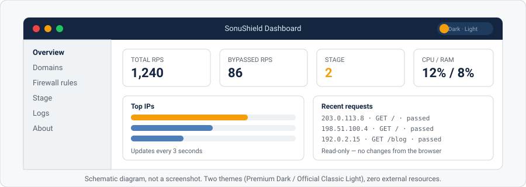

# Dashboard

SonuShield includes a web dashboard and control panel — no build step, no extra files, no external resources. It monitors the proxy and manages it: no terminal interaction is needed for day-to-day operation. It is served two ways from one UI codebase: by the proxy itself on each protected domain (the original mode, still the fallback), and by the [control plane](control-plane.md) from a separate management host (the Cloudflare-style platform model, where operators sign in once and manage every node). This page describes the on-domain mode; the control-plane mode adds a node switcher, reseller/tenant scoping, and account management, and is documented in [Control Plane](control-plane.md).



## Opening It

Open it at:

```text
https://<your-domain>/_bProxy/<adminsecret>/dashboard
```

In Cloudflare mode, open the same path through your Cloudflare-fronted domain as usual (the proxy itself listens on port 80 only in that mode). The dashboard path carries the admin secret, so it is served directly even at a locked stage — it never shows a challenge page.

## Authentication

Two secrets protect the dashboard, reusing the existing API mechanisms — no new authentication scheme is added:

- The page itself is served only on the exact admin-secret path, following the v1 API pattern. A wrong or missing secret never receives the page; the request falls through to normal proxy handling, as with the v1 API. If no admin secret is configured, the dashboard is not served at all.
- After the page loads, enter your `apisecret`. The dashboard sends it only as the `Proxy-Secret` header to the existing API v2 endpoints on the same host. The secret is kept in the browser tab's session storage and is cleared when you click "Forget secret" or close the tab. It is never placed in a URL or written to a log.
- When SSO is configured, a "Sign in with SSO" button appears instead of (or alongside) the secret form: signing in through your identity provider sets a signed session cookie, and API calls then authenticate with that cookie plus a CSRF header — no API secret is typed or stored. Secret-path auth keeps working alone, and either method grants access when configured. See [SSO for the Dashboard](configuration.md#sso-for-the-dashboard). These on-domain SSO paths are superseded once the dashboard moves to the control host, which has its own SSO login — see [Control Plane](control-plane.md#sso).

## What It Shows and Does

- **Overview:** live total and bypassed requests per second, all-time totals, CPU/RAM usage, the current stage and stage-lock state, and the top requesting IPs and unknown fingerprints in the current rate-limit window. Updates every 3 seconds.
- **Domains:** the configured domain list with backends, schemes, live summaries, rule counts, and tenant. Select a domain to manage it everywhere in the dashboard; a detail panel shows its configuration summary and traffic, plus edge-cache analytics and selective purge (path, prefix, or tag) when caching is enabled. A tenants panel lists per-tenant usage (requests, blocked, bandwidth estimate). Admins can also create a domain from a built-in template (WordPress, static site, API backend, e-commerce, plain), bulk-import domains from JSON/CSV, or import nginx/Apache server configs with a dry-run preview — all with full validation, an invalid import changing nothing.
- **Firewall rules:** the domain's rules in evaluation order, with a plain explanation of each action — plus add, edit, and delete, including an optional cron schedule per rule. A visual rule builder generates validated expressions from field/operator/value pickers (validated server-side before saving, like typed rules). Changes are validated, saved to `config.json` immediately (with a rotating backup), and take effect without a reload. A rule simulator evaluates expressions against sample request fields without enforcing anything, and rule sets can be exported as JSON or imported with full validation. Rule packs can be imported from a server file path or URL, and Cloudflare firewall rules can be previewed and applied from the domain's configured token and zone ID (the token is never shown). Edge rules (config-file-only) are not shown here; see [Edge Rules](firewall-rules.md#edge-rules).
- **IP lists:** the domain's allow/block lists with expiry and notes, plus add and remove. Changes are validated, saved to `config.json` immediately (with a rotating backup), and take effect without a reload. Expired entries drop automatically.
- **Stage:** the current stage, stage-lock, and under-attack state — plus controls to return to automatic switching, lock a stage, or switch under-attack mode on and off. Stage changes are runtime-only: a reload or restart resets them. A maintenance-mode panel shows the effective maintenance state (manual override plus scheduled windows) and can enable or disable the override with an optional message and duration.
- **Logs:** the most recent requests that passed the challenges, newest first, with clearing per domain or for all domains — plus structured-log search (filter by IP, action, event, and time window, paginated) when JSON logging is configured, a live tail that streams new entries as they arrive, and a CSP violation-reports panel showing the stored reports for the selected domain.
- **Settings:** domain thresholds, proof-of-work, WAF-lite, and rules dry-run settings, saved to `config.json` immediately; plus a read-only proxy-features panel, a reputation-feed refresh button, and a configuration-backups panel for listing and restoring previous `config.json` versions (validated first, admin role only for restore).
- **Reports:** attack summaries from live counters, with JSON and CSV export — plus an attack map showing top countries from GeoIP data when a database is configured (schematic SVG, no external assets).
- **Insights:** per-domain latency and SLA figures (TTFB/total percentiles, proxy-vs-origin split, error budget), attack timelines with postmortems (JSON or readable text), the configuration security-grade scan, the shadow-mode comparison report, certificate/subdomain status, and real-user monitoring aggregates (navigation-timing percentiles and per-path breakdowns). Latency, grade, shadow, certificate, and RUM panels load when the view opens; the postmortem loads on demand.
- **Approvals:** pending two-person approvals for sensitive control actions, with approve and reject controls. Shown empty with a note when two-person approval is disabled.
- **Reload config** (top bar): validates `config.json` and reloads it into the running proxy. An invalid file is rejected with the reason shown, and the running proxy is untouched.

All data and actions go through the existing [API](api.md) v2 actions. The stage shown comes from the `GET_STAGE` API action and therefore always reflects the domain being inspected.

## What Still Needs the Config File

Secrets are never shown or accepted in the dashboard: admin/API secrets, challenge keys, the Telegram bot token, the email password, webhook URLs (which embed a token), the origin-lock secret, SSO client credentials, the signed-URL secret, canary tokens, and the Cloudflare API token live only in `config.json` on the server. Admin/API secret changes need a restart. Removing domains, and changing backends, schemes, certificate paths, tenant assignments, page templates, security headers, CORS policies, or proxy-wide settings (timeouts, rate limits, GeoIP databases, auto SSL, metrics, logging, GitOps, SSO, branding, Stripe, public API keys, event webhooks), also need a `config.json` edit — after which Reload config here applies the change. (Adding domains is possible from the dashboard via templates and bulk import; see above.) The terminal HUD and commands remain available as a fallback; see [Commands](how-it-works.md#commands).

## Language, Themes, and Offline Use

The dashboard has two themes sharing one layout: Premium Dark (default) and Official Classic Light, switched from the top bar. The choice is stored in the browser's local storage and is never sent to the server. The page is a single self-contained file embedded in the binary: no build step and no external resources (no CDN, fonts, or icon libraries), so it works fully offline and needs no extra files in Docker.

A language toggle next to the theme switch changes the full UI between English and Hindi; the choice persists in the browser's local storage. Data returned by the API (domain names, IPs, log lines) is shown as-is, and technical terms stay in English inside Hindi text. The setup wizard is English-only.

The dashboard is installable as a PWA: a manifest and service worker cache the app shell only (page, manifest, icons), so the installed app opens instantly. API responses and secrets are never cached — the service worker only serves the shell assets under the dashboard's own path, and every data request still goes to the server with authentication. There are no push notifications.

## Next Steps

- [Control Plane](control-plane.md) — the dashboard on a separate management host: owner/reseller/tenant accounts, node switcher, and migration from the on-domain dashboard (`proxy.dashboardMode`).
- [API](api.md) — the endpoints the dashboard uses.
- [How It Works](how-it-works.md) — the terminal HUD and commands.
- [Troubleshooting](troubleshooting.md) — if the dashboard won't load.
