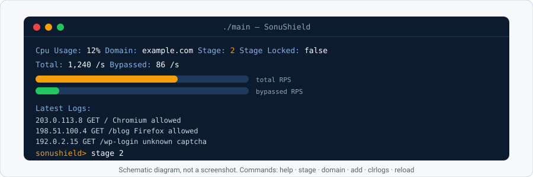
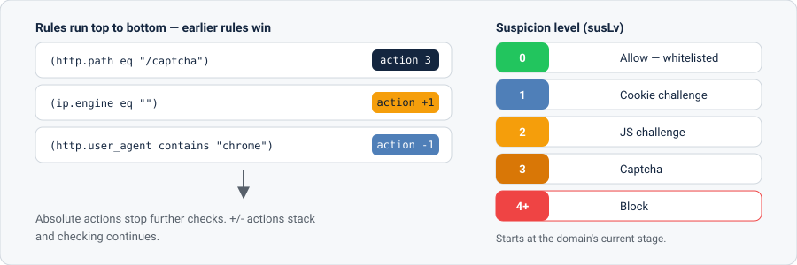

# Features

Everything SonuShield can do today. Every feature below exists in the current code — planned work lives separately in the [Roadmap](roadmap.md).

## TLS Fingerprinting

TLS fingerprinting opens up a whole new range of ways to defend against malicious attacks. You can use it to whitelist specific fingerprints (for example, SEO bots), blacklist unwanted fingerprints (for example, WordPress exploit crawlers), rate-limit attackers that change IPs through proxies, or simply learn more about a visitor.

In Cloudflare mode, TLS fingerprinting is not available: the fingerprint and browser are reported as `Cloudflare` instead. Details: [How It Works](how-it-works.md#tls-fingerprinting).

## Staged DDoS Mitigation

Three challenges, weakest first, escalating automatically when the current one is bypassed: an invisible cookie challenge, a proof-of-work JavaScript challenge, and a custom captcha. Stage switching is driven by per-domain request-rate thresholds, and any stage can be locked manually from the terminal. Details: [How It Works](how-it-works.md#staged-ddos-mitigation).

## DDoS Alerts

SonuShield can notify you over Discord whenever one of your domains comes under attack and when the attack ends. Each alert is a Discord embed titled "DDoS Alert" containing your configured message plus fields for the current total and allowed requests per second. The attack-end alert additionally reports the peak request rates and includes a traffic chart.

Alerts are only sent when the stage is **not** locked, when the first stage starts being bypassed, and when the attack ends. Setup: per-domain [`webhook`](configuration.md#webhook) settings.

## Lightweight

SonuShield is a single static binary designed to run smoothly on small servers with minimal resource use. Everything has its limits, though: it runs on one server, so it cannot absorb volumetric attacks large enough to saturate that server's network connection on its own. For very large attacks, use it together with an upstream protection service.

## Cloudflare Mode

SonuShield can run behind Cloudflare: set `cloudflare` to `true` in your configuration. The proxy listens on port 80 only, reads the client IP from the `Cf-Connecting-Ip` header, does not load TLS certificates, and TLS fingerprinting is unavailable. Your Cloudflare SSL/TLS encryption mode must be set to `Flexible`. Details: [How It Works](how-it-works.md#cloudflare-mode).

## Web Dashboard

A read-only monitoring dashboard served by the proxy itself: live request rates, totals, CPU/RAM, stage, top IPs, firewall rules, and recent logs — in two themes (Premium Dark and Official Classic Light), with no external resources. Details: [Dashboard](dashboard.md).

## Terminal HUD and Commands

While the proxy runs, the terminal shows a live HUD (CPU usage, watched domain, stage, total and bypassed requests per second, latest logs) and accepts commands: `help`, `stage`, `domain`, `add`, `clrlogs`, and `reload`. Details: [How It Works](how-it-works.md#terminal).

## Custom Firewall Rules

Write your own rules with a Wireshark-style expression language (via gofilter): match on IP, browser, fingerprint, path, user agent, stage, request rates, and more, then set or adjust the request's suspicion level — allow, challenge, captcha, or block. Details: [Firewall Rules](firewall-rules.md).

## HTTP API

Two API versions expose proxy statistics, firewall rules, and logs as JSON, authenticated with your `apisecret` (v1 additionally uses the `adminsecret` path). The dashboard itself is built on API v2. Details: [API Reference](api.md).

## Rate Limiting

Per-IP and per-fingerprint rate limits within a configurable time window: total requests, unknown-fingerprint requests, failed challenge attempts, and connections opened without sending a request. Limits that are exceeded block the offender. Details: [Configuration](configuration.md#proxy-settings).
