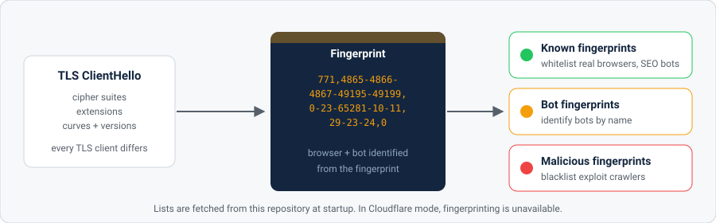
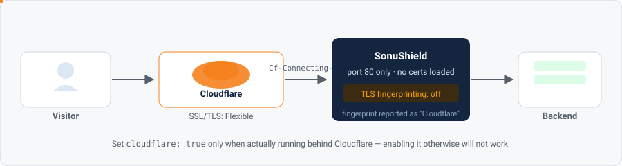
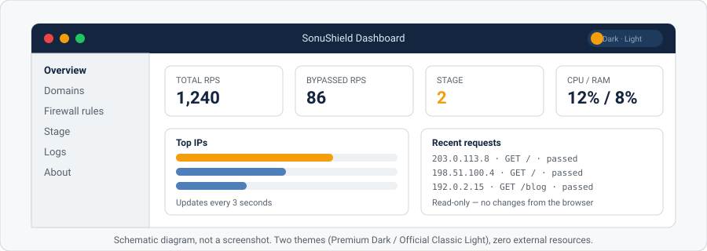

# Features

Everything SonuShield can do today. Every feature below exists in the current code — planned work lives separately in the [Roadmap](roadmap.md).

## TLS Fingerprinting

TLS fingerprinting opens up a whole new range of ways to defend against malicious attacks. You can use it to whitelist specific fingerprints (for example, SEO bots), blacklist unwanted fingerprints (for example, WordPress exploit crawlers), rate-limit attackers that change IPs through proxies, or simply learn more about a visitor.

In Cloudflare mode, TLS fingerprinting is not available: the fingerprint and browser are reported as `Cloudflare` instead. Details: [How It Works](how-it-works.md#tls-fingerprinting).

Alongside the legacy fingerprint, SonuShield computes a JA4 fingerprint for every TLS connection and an `sh1` HTTP request fingerprint (sorted header names, cookie presence, and other request properties). JA4 values can be allow/block-listed like legacy fingerprints and matched in [firewall rules](firewall-rules.md) (`ip.ja4`, `http.fingerprint`). SonuShield JA4 values are computed from the fields Go's TLS stack exposes, so they are only comparable with other SonuShield-computed values — never with external JA4 databases. The built-in JA4 lists start empty; operators add values they observe themselves via `ja4_fingerprints.json` (see [Configuration](configuration.md#ja4-local-overrides)).

## Staged DDoS Mitigation

Three challenges, weakest first, escalating automatically when the current one is bypassed: an invisible cookie challenge, a proof-of-work JavaScript challenge, and a custom captcha. Stage switching is driven by per-domain request-rate thresholds, and any stage can be locked manually from the terminal. Details: [How It Works](how-it-works.md#staged-ddos-mitigation).

## DDoS Alerts

SonuShield can notify you over Discord, Telegram, or email whenever one of your domains comes under attack and when the attack ends. The Discord alert is an embed titled "DDoS Alert" containing your configured message plus fields for the current total and allowed requests per second. The attack-end alert additionally reports the peak request rates and includes a traffic chart. Telegram and email alerts carry the same start/stop events as plain-text messages, with the same custom-message templates.

Alerts are only sent when the stage is **not** locked, when the first stage starts being bypassed, and when the attack ends. Setup: per-domain [`webhook`](configuration.md#webhook) settings for Discord, [`telegram` / `email`](configuration.md#telegram-and-email-alerts) settings for the other channels. Each channel is independent and inert until configured.

## Lightweight

SonuShield is a single static binary designed to run smoothly on small servers with minimal resource use. Everything has its limits, though: it runs on one server, so it cannot absorb volumetric attacks large enough to saturate that server's network connection on its own. For very large attacks, use it together with an upstream protection service.

## Cloudflare Mode

SonuShield can run behind Cloudflare: set `cloudflare` to `true` in your configuration. The proxy listens on port 80 only, reads the client IP from the `Cf-Connecting-Ip` header, does not load TLS certificates, and TLS fingerprinting is unavailable. Your Cloudflare SSL/TLS encryption mode must be set to `Flexible`. Details: [How It Works](how-it-works.md#cloudflare-mode).

## Web Dashboard

A web dashboard and control panel served by the proxy itself: live request rates, totals, CPU/RAM, stage, top IPs, firewall rules, and recent logs — plus stage control, rule editing, domain settings, log clearing, attack reports, and validated config reload, with no terminal interaction needed. Two themes (Premium Dark and Official Classic Light), no external resources. Details: [Dashboard](dashboard.md).

## Terminal HUD and Commands

While the proxy runs, the terminal shows a live HUD (CPU usage, watched domain, stage, total and bypassed requests per second, latest logs) and accepts commands: `help`, `stage`, `domain`, `add`, `clrlogs`, and `reload`. Details: [How It Works](how-it-works.md#terminal).

## Custom Firewall Rules

Write your own rules with a Wireshark-style expression language (via gofilter): match on IP, browser, fingerprint, path, user agent, stage, request rates, and more, then set or adjust the request's suspicion level — allow, challenge, captcha, or block. Details: [Firewall Rules](firewall-rules.md).

## Adaptive Proof-of-Work

With `adaptivePow` enabled per domain, the Stage 2 puzzle difficulty scales with load — easy under normal traffic, progressively harder as an attack that bypasses Stage 1 grows — within operator-set bounds. Legitimate visitors under normal load notice nothing different. Details: [Configuration](configuration.md#adaptive-proof-of-work).

## Turnstile / hCaptcha Challenges

A domain can serve a Cloudflare Turnstile or hCaptcha challenge instead of the proof-of-work page, using the operator's own provider keys. The challenge uses the provider's invisible-mode widget with automatic execution, so legitimate visitors see only a brief verifying page. Without keys the feature is inert and proof-of-work is used. Details: [Configuration](configuration.md#challenge-providers).

## Geo / ASN Rules and IP Reputation

Firewall rules can match on country (`ip.country`) and ASN (`ip.asn`) using operator-supplied MaxMind DB files, and on IP reputation (`ip.reputation`) using a local blocklist plus an optional external feed. Both are fail-open: a missing database or a failed feed fetch never blocks anyone. Details: [Configuration](configuration.md#geo-and-asn-rules) and [IP Reputation](configuration.md#ip-reputation).

## WAF-Lite

Conservative inspection for common SQL injection, cross-site scripting, and path-traversal shapes, plus WordPress login-flood protection. Log-only by default — matches are logged and the request continues — with opt-in per-domain blocking that answers with a generic unbranded 403. Details: [Configuration](configuration.md#waf-lite).

## Automatic SSL

With `autoSSL` enabled, domains without certificate files get Let's Encrypt certificates automatically (ACME HTTP-01), cached on disk and renewed without operator action. Domains with explicit certificates keep using them. Details: [Configuration](configuration.md#automatic-ssl).

## Quiet Mode

With `quietMode` enabled, visitor-facing output carries no product identification: no `SonuShield` response header, generic block and error messages, and a generic unknown-host page. Attribution is unaffected — the credits endpoint, license, and docs credits always stay. Details: [Configuration](configuration.md#quiet-mode).

## Prometheus Metrics

With `metricsEnabled` set, the proxy exposes request, block, and challenge counters, request-rate gauges, stage, and backend latency histograms in Prometheus exposition format, per domain. The endpoint is disabled by default and, when enabled, served only on the admin-secret path — it is never open, and scrapes are neither challenged nor counted. Details: [Configuration](configuration.md#prometheus-metrics).

## Attack Reports

The `GET_ATTACK_REPORT` API action returns a summary of the current or most recent attack for a domain — window, totals, current and peak rates, actions taken (blocks, challenges, WAF matches, backend results), and the top IPs, fingerprints, and countries — as JSON or CSV. With `reportDirectory` set, one JSON + CSV pair is also written per finished attack. Reports contain metadata only: no bodies, cookies, or secrets. Details: [Configuration](configuration.md#attack-reports) and [API Reference](api.md#domain-actions).

## Structured Logs

With `logFormat: "json"` and a `logFile` path, the proxy writes one JSON line per event — allowed requests, blocks, challenges, WAF matches, and attack start/end — with consistent fields (timestamp, level, domain, IP, action, rule, fingerprints, stage, path). Size-based rotation bounds disk use. The default text output is unchanged when JSON logging is off. Details: [Configuration](configuration.md#structured-logs).

## HTTP API

Two API versions expose proxy statistics, firewall rules, and logs as JSON, authenticated with your `apisecret` (v1 additionally uses the `adminsecret` path). They also expose feature controls: read live feature settings, adjust adaptive proof-of-work and WAF-lite settings at runtime, and trigger a reputation-feed refresh. The dashboard itself is built on API v2. Role-mapped secrets (`viewer`, `operator`, `admin`) limit what each caller may do, and every call is audit-logged. Details: [API Reference](api.md).

## HTTP/2 Fingerprinting

For HTTP/2 connections, SonuShield builds an additional fingerprint from the signals Go's stack exposes — protocol version, TLS version/cipher, ALPN, a hash of the sorted header names, and presence flags for common headers — available as the `http.http2` rule field and on `/_bProxy/fingerprint`. HTTP/2 SETTINGS frames, WINDOW_UPDATE, and PRIORITY frames are not observable through Go's `net/http`, and HTTP/1 header order is not preserved by Go, so neither is claimed. Details: [Firewall Rules](firewall-rules.md).

## Honeypot Endpoints and Fake Search-Bot Verification

Operator-configured decoy paths (exact, case-sensitive) raise suspicion on requests that hit them — paths no legitimate visitor ever requests. Claimed Googlebot/Bingbot user-agents can be verified by reverse+forward DNS, with fail-open on DNS errors and results cached; failures raise suspicion and set the `ip.searchbot` rule field. Both are off unless configured. Details: [Configuration](configuration.md#honeypot-endpoints).

## Tarpit

Blocked requests can be answered after a configurable delay, wasting attackers' connection slots, with capped concurrency so tarpitted connections can never exhaust the proxy. It never applies to allowed or challenged requests. Off by default. Details: [Configuration](configuration.md#tarpit).

## Edge Caching and Waiting Room

Safe, cacheable GET responses can be cached in memory per domain (bounded size and lifetime, honoring `Cache-Control: private`/`no-store`, never caching `Set-Cookie` or authorized responses), with purge via the API or dashboard. When load crosses a threshold, a waiting room queues excess visitors fairly instead of dropping them. Both are off by default. Details: [Configuration](configuration.md#edge-caching).

## Load Balancing, Failover, and Health Checks

A domain can list several backends with round-robin or least-connections distribution, failover away from failing backends (with replay-safe retries), and optional active health checks. When every backend is down, a stale cached copy is served, clearly marked, instead of the error page. Single-backend configs behave exactly as before. Details: [Configuration](configuration.md#load-balancing-and-failover).

## WebSocket Support

WebSocket upgrades proxy bidirectionally, with an optional per-domain idle timeout on a dedicated upgrade path that also honors load balancing and failover. Details: [Configuration](configuration.md#websocket-support).

## API Protection

API routes can require JWT bearer tokens (HS256 secret or RS256/ES256 via JWKS), per-API-key rate limits, and GraphQL query depth/field limits. All are off unless configured; invalid configuration fails closed for the affected route only. Tokens and keys are never logged. Details: [Configuration](configuration.md#api-protection).

## Roles, Audit Log, and Config Rollback

Additional API secrets map to `viewer`, `operator`, and `admin` roles, and every control-plane action is audit-logged with its role, parameters (scrubbed), and result. Config writes keep rotating backups, and an admin can list and restore a previous version through the API or dashboard, with the same validation as a reload. Details: [Configuration](configuration.md#api-roles-and-audit-log).

## Rule Simulator, Dry-Run, and Export/Import

A rule expression can be evaluated against sample request fields without enforcing anything, and a domain can run its rules in dry-run mode — matches logged, no action taken. Rule sets export as JSON and import with full validation (invalid imports change nothing). All three are in the dashboard's Firewall rules view. Details: [API Reference](api.md#domain-actions).

## Risk Score, Shared Reputation, and Behavior Detection

Every request gets a composite risk score (0–100) from suspicion level, fingerprint trust, reputation, geography, and behavior signals, with fixed documented weights — usable in firewall rules as `ip.risk`, and summarised in logs and attack reports. It is a heuristic, never a verdict. Domains can opt in to sharing IP/fingerprint reputation with each other, and inhuman request timing (perfectly regular intervals, superhuman bursts) is detected with conservative thresholds — log-only by default, enforcement opt-in. Details: [Configuration](configuration.md#risk-score).

## Per-Session Limits, Connection Caps, and Payload Limits

Rate limits can be keyed to the challenge-cookie session as well as the IP, so one abusive session behind shared NAT does not punish everyone on that IP. A per-IP concurrent-connection cap blunts slow-connection attacks, and request bodies are limited globally and per route (32 MiB default) with a clean `413`. Ambiguous `Content-Length`/`Transfer-Encoding` framing is normalised by Go's server and re-framed by the proxy, so the origin never sees it. Details: [Configuration](configuration.md#per-session-limits).

## Origin Lock, Security Headers, and CORS

The proxy can add a shared-secret header on every backend request so the origin rejects traffic that bypassed the proxy, apply configurable response security headers, and enforce per-domain CORS policies with fail-closed validation and direct preflight answers. All are off by default. Details: [Configuration](configuration.md#origin-lock).

## IP Manager, Custom Challenge Pages, and Hindi

Allow/block lists with optional expiry are managed from the dashboard or API and persisted to the config file — no list is ever bundled. Challenge pages (proof-of-work, captcha, waiting room) accept operator-provided HTML templates with a safe placeholder set and no arbitrary scripts, and the built-in challenge pages are available in Hindi by `Accept-Language`, with English fallback. Details: [Configuration](configuration.md#ip-allow-and-block-lists).

## Log Search, Attack Map, and Status Page

The structured JSON log is searchable through the API and dashboard (filter by domain, IP, action, and time window; bounded and paginated), and an attack overview shows top countries from GeoIP data only when the operator configured a database — schematic SVG only, zero external assets. An opt-in public status page reports uptime and per-domain health with no sensitive data, plus a bare `/_bProxy/health` liveness check for scrubbing providers and load balancers. Details: [Configuration](configuration.md#status-page) and [Scrubbing-Center Integration](scrubbing-integration.md).

## Multi-Tenancy, Metering, GitOps, and SSO

Domains group per tenant, with per-tenant usage counters (requests, blocked, bandwidth estimate) and tenant-scoped API roles that see only their own domains. Configuration can sync from a local git checkout through the validated reload path — a bad synced config can never take the proxy down. The dashboard supports optional OIDC login (PKCE, JWKS-verified ID tokens, signed session cookies) alongside the existing secret-path auth. Details: [Configuration](configuration.md#multi-tenancy-and-metering).

## Rate Limiting

Per-IP and per-fingerprint rate limits within a configurable time window: total requests, unknown-fingerprint requests, failed challenge attempts, and connections opened without sending a request. Limits that are exceeded block the offender. Details: [Configuration](configuration.md#proxy-settings).
