# Challenges

The staged challenges visitors may meet, and the ways they adapt.

> [← Feature index](../features.md)

Every diagram on this page is an animated schematic: it shows the mechanism in motion, not a screenshot. Diagrams use SMIL animation only, so they animate on GitHub.

## Staged Challenges

### How it works

Three challenges, weakest first, escalating automatically when the current one is bypassed. **Stage 1** is an invisible cookie challenge every browser and most HTTP libraries pass; **Stage 2** is a proof-of-work JavaScript puzzle the browser solves automatically; **Stage 3** is a custom slider captcha — the last resort, which stops good bots too. Switching is driven by per-domain thresholds: when bypassing requests per second exceed `bypassStage1`, Stage 2 activates; past `bypassStage2`, Stage 3. Stages step back down when both bypassing and total rates fall below the matching `disable*` thresholds. Any stage can be locked manually (`stage` command, dashboard, or API); a locked stage disables automatic switching until unlocked. Firewall rules can raise a request's suspicion level above the current stage, and level 4+ blocks outright.

### Configuration

Per domain: `bypassStage1`, `bypassStage2`, `disableBypassStage3`, `disableRawStage3`, `disableBypassStage2`, `disableRawStage2`, `stage2Difficulty` (default `5` when `0`). Stage locks are runtime-only: a reload or restart resets them.

### Limits

- Stage 2's page loads the `balooPow` solver script from a public CDN — visitors' browsers must reach that CDN for Stage 2 to complete. (The solver repository carries no licence, so vendoring is not permitted.)
- A stage higher than 3 blocks all requests — locking is a sharp tool.

See also: [How It Works](../how-it-works.md#staged-ddos-mitigation) · [Stage Thresholds](../configuration.md#stage-thresholds)

---

## Adaptive Proof-of-Work

### How it works

With `adaptivePow` enabled, the Stage 2 difficulty scales linearly with the domain's bypassed requests per second between `bypassStage1` (minimum applies) and `bypassStage2` (maximum applies). Under normal load visitors get the minimum difficulty; as an attack that bypasses Stage 1 grows, the puzzle gets progressively harder. Bounds default to the base difficulty and base +3, and the result is always clamped to 1–16 — each +1 multiplies client work roughly 16×. The toggle and bounds can also be adjusted at runtime via `SET_DOMAIN_FEATURES` (runtime-only, not persisted).

### Configuration

Per domain: `adaptivePow` (default `false`), `powDifficultyMin` (`0` = base difficulty, clamped 1–16), `powDifficultyMax` (`0` = base +3, clamped 1–16). Disabled by default; fixed `stage2Difficulty` behavior is unchanged when off.

### Limits

- Difficulty is a blunt cost knob: very high values punish low-end phones first. Start with the defaults and watch real solve times.
- Adaptive scaling reacts to bypassed load only — a flood that never passes Stage 1 never raises difficulty.

See also: [Configuration](../configuration.md#adaptive-proof-of-work)

---

## Memory-Hard Proof-of-Work (Argon2id)

### How it works

An opt-in Stage 2 alternative for attackers running GPU/ASIC hash solvers: the visitor's browser runs a pure-JavaScript Argon2id solver (embedded in the binary — no CDN, no WebAssembly) and submits the counter it found; the server verifies with a single Argon2id computation. The puzzle is bound to a single-use nonce tied to the visitor's IP, TLS fingerprint, and user-agent, expiring after 10 minutes. Defaults target roughly half a second of solving on a laptop and one to two seconds on a phone (measured ~31 ms per evaluation at 512 KiB / 1 iteration; 4 bits needs ~16 evaluations on average). A provider challenge still takes precedence when configured; challenge rotation takes precedence over both.

### Configuration

Per domain: `memoryHardPow` (default `false`), `memoryHardPowBits` (default `4`, clamped 1–8), `memoryHardPowMemoryKB` (default `512`, clamped 256–8192), `memoryHardPowTime` (default `1`, clamped 1–3).

### Limits

- Never combine high values: 8 MiB with 3 iterations and 8 bits takes minutes on a phone. Raise one parameter at a time, testing on a real low-end phone.
- The classic puzzle stays the default; this is an opt-in alternative, not a replacement.

See also: [Configuration](../configuration.md#memory-hard-proof-of-work)

---

## Challenge Rotation

### How it works

With `challengeRotation` set, the served Stage 2 challenge type rotates through the listed types instead of always serving the same one, so an attacker cannot settle on a single solver. Type names are case-insensitive: `pow`, `memoryPow` (only when memory-hard PoW is enabled), `turnstile` / `hcaptcha` (only when the domain is configured for that provider, with keys), and `captcha`. Unknown names are dropped, duplicates collapse, and unavailable types are skipped; if no listed type is available, rotation is inert and the fixed chain runs, with the classic puzzle as the ultimate fallback. Modes: `wave` (advance at the start of each attack wave, the default) or `request` (round-robin per served challenge). Rotation state resets on restart and survives reloads.

### Configuration

Per domain: `challengeRotation` (array, empty default), `challengeRotationMode` (`wave` default / `request`). The policy is visible read-only via `GET_DOMAIN_FEATURES`; the live current type is not exposed.

### Limits

- Each domain has a single provider configuration, so rotating between Turnstile and hCaptcha on the same domain is not possible.
- Rotation changes which challenge is served, not the stage thresholds that decide when Stage 2 activates.

See also: [Configuration](../configuration.md#challenge-rotation)

---

## Turnstile / hCaptcha Challenges

### How it works

A domain can serve a Cloudflare Turnstile or hCaptcha challenge instead of the Stage 2 proof-of-work page, using the operator's own provider keys. The page uses the provider's invisible-mode widget with automatic execution, so legitimate visitors see only a brief verifying page unless the provider decides otherwise. Verification happens server-side against the provider's `siteverify` API; a failed or missing token fails closed with a generic error, and on success the visitor receives the same clearance cookie as the proof-of-work flow. If the provider is misconfigured (unknown name or missing keys), a startup warning is logged and the domain falls back to proof-of-work.

### Configuration

Per domain: `challengeProvider` (`turnstile` / `hcaptcha`, empty default), `challengeSiteKey`, `challengeSecretKey` (config-file-only; never returned by the API, never settable through it).

### Limits

- Whether the widget stays fully invisible also depends on the site key's settings in the provider's dashboard.
- Live provider flows are unverifiable without operator keys and a real domain; the plumbing was verified against mocks.
- The provider page is not customisable via `pageTemplates`.

See also: [Configuration](../configuration.md#challenge-providers)

---

## Passkey Challenge (WebAuthn)

### How it works

A WebAuthn assertion challenge as an alternative to the captcha at Stage 3, for enrolled users. The passkey page is served only when at least one credential is enrolled; otherwise the captcha is used, so the feature can never strand visitors. Assertions are verified server-side: type, single-use challenge nonce (bound to IP/TLS/user-agent, 10-minute TTL), origin, RP ID hash, User Present flag, ES256/RS256 signature, and a monotonic sign counter. Enrollment is out-of-band via the API (`ENROLL_PASSKEY`, admin role) with operator-supplied JWK values — there is no registration ceremony in the proxy, and only public-key material is ever stored (credential ID, JWK public key, user handle, label, sign count, in a file written atomically with `0600` permissions).

### Configuration

Per domain: `passkey` object — `enabled`, `rpId`, `rpName`, `origins` (default `https://<rpId>`), `credentialsFile`. `LIST_PASSKEYS` (viewer) returns metadata only; `REMOVE_PASSKEY` (operator) removes a credential.

### Limits

- No registration ceremony exists in the proxy: credentials must be enrolled with values obtained elsewhere.
- The feature was verified end-to-end with a test signer, not against real platform authenticators in production.

See also: [Configuration](../configuration.md#passkey-challenge)

---

## Custom Challenge Pages + Hindi

### How it works

`pageTemplates` replaces the built-in PoW, captcha, and waiting-room pages with operator-provided HTML. Placeholders are substituted with HTML-escaped values (`{{publicSalt}}`, `{{challenge}}`, `{{difficulty}}`, `{{captchaImage}}`, `{{maskImage}}`, `{{publicPart}}`, `{{position}}`, plus optional `{{message}}` on every template), and each template must contain its required placeholders or the built-in page is served with a warning. Safety rules: `<script>` tags are stripped with a warning — no arbitrary script execution beyond the existing proof-of-work flow, whose fixed solver script is appended to PoW templates automatically — and captcha templates must keep the element IDs the built-in captcha script expects. The built-in PoW, captcha, provider-verifying, and waiting-room pages are also available in Hindi, served when `Accept-Language` starts with `hi`, with English fallback.

### Configuration

Per domain: `pageTemplates` object with `pow`, `captcha`, `waitingRoom` keys. The Turnstile/hCaptcha provider page is not customisable. Terse plain-text block messages stay in English.

### Limits

- Custom templates receive no branding injection and no invisible markers beyond what the fixed scripts provide.
- A template missing required placeholders is disabled silently apart from a warning — check the log after deploying one.

See also: [Configuration](../configuration.md#custom-challenge-pages)

---

## Quiet Mode

### How it works

With `quietMode` enabled, visitor-facing output carries no product identification: the `SonuShield` response header is not set, block messages lose the `Blocked by SonuShield.` prefix, captcha error pages lose the product name, and the unknown-host message on port 80 becomes a generic "`<host>` does not exist." Default output (quiet mode off) is byte-identical to before. Quiet mode affects only what site visitors see — it never affects authorship attribution: the `/_bProxy/credits` endpoint, the LICENSE file, README/docs credits, and code-level credits are always present and unchanged.

### Configuration

`proxy.quietMode` (default `false`).

### Limits

- Quiet mode hides identification, not existence: challenge behavior itself is still observable by a determined prober.
- It does not change the credits endpoint, license, or docs — and must never be used to imply otherwise.

See also: [Configuration](../configuration.md#quiet-mode)

---

## Challenge-Flow Exemption

### How it works

Secret-authenticated API and dashboard requests are exempt from the challenge flow: the secret is checked before any challenge is served, so management access works even at a locked Stage 3. A request with a missing or wrong secret is not exempt — it meets the challenge like any other visitor — so the exemption cannot be abused to bypass challenges without a secret. This closed a Batch 5 limitation where the public API returned challenge pages instead of JSON errors at Stage 1+; management paths now always answer JSON.

### Configuration

No configuration keys: built into the request pipeline. The exemption applies to `/_bProxy/` management paths with valid secrets.

### Limits

- Exemption is per-request: each management call must carry its secret; there is no exempt IP list.
- The exemption covers management paths only — it never exempts ordinary site traffic.

See also: [How It Works](../how-it-works.md)

---

---

[← All features](../features.md)
