# Detection & Fingerprinting

How SonuShield identifies clients and scores requests before deciding anything.

Every diagram on this page is an animated schematic: it shows the mechanism in motion, not a screenshot. Diagrams use SMIL animation only, so they animate on GitHub.

## TLS Fingerprinting

### How it works

Every TLS connection is fingerprinted from its ClientHello before any HTTP is read. At startup the proxy fetches three legacy fingerprint lists from its own repository — known, bot, and malicious — and matches the computed fingerprint against them to identify the browser or bot. A fingerprint on the malicious list blocks the request outright, exactly like a forbidden fingerprint; a known browser fingerprint counts as a trust signal in the risk score, and the raw value is exposed to firewall rules as `ip.fingerprint` and forwarded to the backend as the `proxy-tls-fp` header.

### Configuration

No configuration keys: fingerprinting is always on outside Cloudflare mode. Lists are fetched from the SonuShield repository at startup; fetch failures leave the affected lists empty without stopping startup.

### Limits

- In Cloudflare mode there is no TLS fingerprint: the fingerprint and browser are reported as `Cloudflare`.
- A fingerprint identifies a TLS stack, not a person — shared stacks (browsers, libraries) share fingerprints.

See also: [How It Works](../how-it-works.md#tls-fingerprinting) · [Firewall Rules](../firewall-rules.md)

---

## JA4 Fingerprinting

### How it works

Alongside the legacy fingerprint, SonuShield computes a JA4 fingerprint for every TLS connection from the fields Go's TLS stack exposes: TLS version, cipher suite, extension set, and ALPN. JA4 values can be allow/block-listed exactly like legacy fingerprints, matched in firewall rules as `ip.ja4`, and consulted to fill in browser/bot identification when the legacy fingerprint is unknown. The built-in JA4 lists start empty; operators teach the proxy values they observed themselves via an optional `ja4_fingerprints.json` file next to `config.json`, whose entries merge over the fetched lists and win on key conflicts.

### Configuration

No config keys. Local overrides live in `ja4_fingerprints.json` (`known` / `bot` / `malicious` maps). A missing file is a silent no-op; an unparseable file logs a warning and keeps the fetched lists.

### Limits

- SonuShield JA4 values are computed only from the fields Go exposes — the raw extension list is not included — so they are comparable only with other SonuShield-computed values, never with external JA4 databases.
- Only JA4 values observed on your own proxy (see `/_bProxy/fingerprint`) belong in the local file.

See also: [Configuration](../configuration.md#ja4-local-overrides) · [List provenance](../../global/fingerprints/SOURCES.md)

---

## sh1 HTTP Fingerprint

### How it works

`http.fingerprint` is SonuShield's own HTTP request fingerprint, `sh1_<a>_<b>_<c>_<d>`, built only from the headers of the request being evaluated. Section **a** captures the request shape (method, version, cookie/referer presence, header count, first Accept-Language tag); **b** is a truncated SHA-256 of the sorted lowercase header names; **c** hashes the sorted cookie *names* (values never included); **d** hashes normalised client-preference signals — sorted Accept-Encoding tokens, the full Accept-Language value, Upgrade-Insecure-Requests, and Sec-Fetch-Site/Mode. No scripts, no evercookies, no cross-site tracking: raw header values are hashed, never stored.

### Configuration

No configuration keys: computed for every request. Values from before Batch 5 (three sections) are not comparable with current four-section values.

### Limits

- Deliberately not JA4H: JA4H needs the original header transmission order, which Go's `net/http` does not preserve, and sits under a licence needing an OEM agreement for commercial use.
- Clients behind header-normalising proxies share fingerprints.

See also: [Firewall Rules](../firewall-rules.md#the-sh1-http-fingerprint)

---

## HTTP/2 Fingerprinting

### How it works

For HTTP/2 connections SonuShield builds an additional fingerprint from exactly the signals Go's server stack exposes: protocol version, TLS version/cipher, ALPN, a hash of the sorted header names, and presence flags for common headers. It is available as the `http.http2` rule field and on the `/_bProxy/fingerprint` page, so HTTP/2-only bot stacks can be told apart from browsers even when their TLS fingerprints coincide. HTTP/1.x requests get an empty value.

### Configuration

No configuration keys: computed for every HTTP/2 connection.

### Limits

- HTTP/2 SETTINGS order/values, WINDOW_UPDATE, and PRIORITY frames are not observable through Go's `net/http` and are not included; HTTP/1 header order is not preserved by Go either, so no header-order fingerprinting is claimed for HTTP/1.

See also: [Firewall Rules](../firewall-rules.md)

---

## QUIC Fingerprinting (ip.quic)

### How it works

Every HTTP/3 request carries a QUIC fingerprint in the `ip.quic` firewall rule field, formatted `q1:<quic-version>:<tls-version>-<cipher>:<alpn>:<flags>`. The four flag bits are real peer handshake signals: session resumed, 0-RTT used, QUIC datagrams advertised, and stream-reset partial delivery advertised. TCP requests get an empty value, so rules on `ip.quic` never match TCP traffic. The QUIC listener reuses the TCP TLS configuration, so the legacy TLS fingerprint and JA4 populate for QUIC handshakes too.

### Configuration

Requires `proxy.http3.enabled: true` (see [HTTP/3](../http3.md)). No separate fingerprinting toggle exists.

### Limits

- quic-go's public API does not expose raw QUIC transport parameters, packet-level behavior, or version-negotiation attempts — none are in the fingerprint.
- Passive OS fingerprinting does not apply to QUIC: `ip.os` and `ip.tcpinfo` stay empty for HTTP/3 requests.
- UDP socket delivery and browser interop were never tested (the build VM blocks UDP); verified by an in-process end-to-end test only.

See also: [HTTP/3](../http3.md) · [Firewall Rules](../firewall-rules.md)

---

## Passive OS Fingerprinting

### How it works

The proxy classifies a client's OS family from passively observable TCP signals only — the send/receive MSS, smoothed RTT, and negotiated options bitmask (timestamps, SACK, window scaling, ECN) read through `TCP_INFO` on Linux. Classification is by operator-supplied signatures in `proxy.osSignatures`: a signature matches when every non-zero field matches, first match wins, and the label is exposed as `ip.os` with the raw signals rendered as `ip.tcpinfo`. With no signatures configured, `ip.os` is always `unknown` — the proxy ships no signature database and invents no values.

### Configuration

`proxy.osSignatures`: array of `{"label", "sndMss", "rcvMss", "wscale", "timestamps", "sack"}`. Empty (default) means every client reports `unknown`.

### Limits

- Classic p0f signals are unavailable: TTL, DF flag, TCP option order, window-scale value, and initial window size cannot be observed through Go's stack.
- On non-Linux platforms the collector is a stub; in Cloudflare mode no client TCP connection is ever seen, so `ip.os` stays `unknown`.

See also: [Configuration](../configuration.md#passive-os-fingerprinting)

---

## Geo / ASN Rules

### How it works

Firewall rules can match on `ip.country` (ISO code) and `ip.asn` (autonomous system number) using operator-supplied MaxMind DB files. The two databases are independent — configure either, both, or neither — and lookups happen per request with fail-open semantics: a missing database, an unreadable file, or an IP with no record yields `""` / `0`, and rules simply do not match on that field. In Cloudflare mode the `CF-IPCountry` header supplies the country instead of the database; the ASN still comes from the database.

### Configuration

`proxy.geoipCountryDatabase` / `proxy.geoipASNDatabase`: paths to `.mmdb` files. Empty disables that lookup. No database is bundled — download GeoLite2 files with your own MaxMind account and licence key.

### Limits

- Geolocation is approximate: VPNs, proxies, and stale records misplace clients. Never treat a country match as proof of anything on its own.
- Database files are never committed (see `.gitignore`).

See also: [Configuration](../configuration.md#geo-and-asn-rules)

---

## IP Reputation

### How it works

A local blocklist plus an optional external feed feed the `ip.reputation` rule field (`"listed"` or `""`). Listed IPs get their suspicion level bumped by `reputationSusLv` after firewall rules run. The feed is plain text — one IP or CIDR per line, `#` comments, only the first field read, capped at 10 MB — fetched in the background at startup and every `reputationFeedInterval` minutes; startup never blocks on it. On any fetch or parse failure the last good data is kept and a warning is logged: feed errors never block anyone. `REFRESH_REPUTATION_FEED` triggers a refresh on demand.

### Configuration

`proxy.reputationBlocklist` (array), `proxy.reputationFeedURL` (empty disables), `proxy.reputationFeedInterval` (default `60`, minimum `5` minutes), `proxy.reputationSusLv` (default `1`). No list is bundled and no feed is contacted unless configured.

### Limits

- A reputation hit is a signal, not a verdict: shared IPs (NAT, VPN exits, CGNAT) can carry another tenant's history.
- Feed status is visible via `GET_PROXY_FEATURES`; feed contents are never logged.

See also: [Configuration](../configuration.md#ip-reputation)

---

## Cross-Domain Reputation Sharing

### How it works

Domains on the same proxy can share IP/fingerprint reputation: an attacker blocked on one domain starts with elevated suspicion on the others. Both directions are opt-in per domain — a domain without `shareReputation: true` neither contributes nor consumes — and the store only ever adds suspicion, never blocks. Entries expire after 10 minutes. Only blocks from the WAF and the suspect-block path are recorded; rate-limit and fingerprint-list blocks are already proxy-wide signals and are not recorded again. Sharing fails open: if the store is unavailable, requests are evaluated normally.

### Configuration

Per domain: `shareReputation` (default `false`), `sharedReputationSusLv` (default `1`).

### Limits

- Sharing is proxy-local: it does not cross SonuShield instances (see Threat Sharing for that).
- A shared flag adds suspicion only; it cannot block on its own.

See also: [Configuration](../configuration.md#cross-domain-reputation-sharing)

---

## Risk Score (ip.risk)

### How it works

Every request gets a composite risk score from `0` to `100`, combining the signals known at evaluation time with fixed, documented weights: stage at arrival (0/10/30/50/70), known fingerprint −10, bot-listed +25, unknown fingerprint +15, reputation-listed +25, shared reputation +15, timing anomaly +20, challenge failures +10/+20, high-risk country +15, high-risk ASN +15 — clamped to `0`–`100`. The score is exposed as the `ip.risk` rule field, as `risk_score` in structured logs, and as average/max/sample-count in attack reports. Geography contributes nothing unless the operator configures the high-risk lists and a GeoIP database.

### Configuration

Per domain: `riskHighRiskCountries` (ISO codes, empty default), `riskHighRiskASNs` (AS numbers, empty default). Weights are fixed; there are no hidden inputs and no tuning knobs.

### Limits

- The score is a heuristic for ranking and clustering — never a guarantee. A high score never proves malice; do not block on it alone without understanding the weights.
- Same-request honeypot and fake-bot hits are not inputs: they raise suspicion directly after the score is computed.

See also: [Configuration](../configuration.md#risk-score)

---

## Timing & Behavior Detection

### How it works

The proxy watches per-IP request timing for inhuman patterns and logs them as `timing` events (at most once per IP per minute). Two patterns are detected with deliberately conservative thresholds: **regular** — 12 or more requests with a coefficient of variation under `0.08` and a mean interval under 500 ms (slow exact polling at 1 second or more is never flagged) — and **burst** — 50 or more requests inside a 1-second window. The verdict is available to firewall rules as `ip.timing` (`""`, `"regular"`, or `"burst"`). Detection is log-only by default; `timingEnforce` applies the suspicion bump.

### Configuration

Per domain: `timingEnforce` (default `false`, log-only), `timingSusLv` (default `1`). Thresholds are fixed in code, not configurable.

### Limits

- Legitimate bursts (page loads, API retries) can look bursty — which is why enforcement is opt-in and thresholds are conservative.
- Timing is one signal among many; it never blocks on its own.

See also: [Configuration](../configuration.md#timing-and-behavior-detection)

---

## Mouse / Scroll Behavior Check

### How it works

When enabled, challenge pages served by the proxy include a small script that reports only three booleans via `sendBeacon` on page unload: whether the mouse moved, whether the page scrolled, and a coarse elapsed-time bucket. No coordinates, no keystrokes, no cross-site tracking, and no identifier beyond the existing challenge cookie. A client is flagged bot-like only when it shows no mouse or scroll activity *and* completes the challenge in under 1.5 seconds; slower no-interaction clients are inconclusive and never flagged. The verdict is available as `ip.behavior` (`human`, `bot`, or empty), log-only by default.

### Configuration

Per domain: `behaviorCheck` (default `false`), `behaviorEnforce` (default `false`, log-only), `behaviorSusLv` (default `1`).

### Limits

- The signal is collected only on challenge pages, never on normal pages — most legitimate visitors are never measured.
- Keyboard-only and assistive-technology users may show no mouse/scroll activity; the 1.5-second rule plus log-only default exist for exactly that reason.

See also: [Configuration](../configuration.md#behavior-check)

---

## Fake Search-Bot Verification

### How it works

With `fakeBotCheck` enabled, requests whose user-agent claims to be Googlebot or Bingbot are verified by reverse DNS — the IP must resolve to a hostname under `googlebot.com`, `google.com`, or `search.msn.com` — followed by forward DNS, where that hostname must resolve back to the same IP. A failed verification raises suspicion, logs a `fakebot` event, and sets `ip.searchbot` to `"fake"`; a verified bot sets it to `"verified"`. DNS failures and timeouts fail open (`"unchecked"`, nothing bumped). Results are cached: 1 hour for verified/fake, 5 minutes for unchecked. The check only runs for user-agents that claim to be a search bot.

### Configuration

Per domain: `fakeBotCheck` (default `false`), `fakeBotSusLv` (default `3`).

### Limits

- Only Googlebot/Bingbot claims are verified; other claimed bots are untouched.
- DNS-based verification trusts DNS: a poisoned resolver could mislead it. The fail-open design bounds the damage to a missed fake bot, never a blocked real one.

See also: [Configuration](../configuration.md#fake-search-bot-verification)

---

## Honeypot Endpoints

### How it works

`honeypotPaths` lists decoy paths that legitimate visitors never request — an old admin URL, a backup file, a path only scanners probe. Matching is exact and case-sensitive with no prefix matching, so a decoy can never catch a real page that merely shares a prefix. A request hitting a decoy has its suspicion level raised by `honeypotSusLv` and is logged as a `honeypot` event in the structured log. With no paths configured the honeypot is fully disabled and costs nothing.

### Configuration

Per domain: `honeypotPaths` (array, empty default), `honeypotSusLv` (default `2`).

### Limits

- Choose paths that appear in no link, sitemap, or redirect: a path real users can reach will raise suspicion on real users.
- The honeypot raises suspicion; it does not block on its own.

See also: [Configuration](../configuration.md#honeypot-endpoints)

---

## Canary Tokens

### How it works

Decoy paths and credentials that no legitimate visitor should ever touch. Hitting a canary path (exact, case-sensitive match) or presenting a canary token as a bearer token, API key, or `api_key`/`apikey` parameter immediately answers a generic 403, raises maximum suspicion, and fires an alert on the existing alert channels — rate-limited to one per IP per hour. Token values are never logged, never returned by the API, and never included in alerts. With none configured, canaries are fully inert.

### Configuration

Per domain: `canaryPaths` (array, empty default), `canaryTokens` (array, empty default). Token values are config-file-only.

### Limits

- A canary that leaks into real traffic (a shared doc, a committed config) will fire on legitimate users — plant canaries only where attackers look.
- Canary trips can optionally be shared with threat-sharing peers (`pushOnCanary`).

See also: [Configuration](../configuration.md#canary-tokens)

---

## Invisible Markers

### How it works

When enabled, challenge pages the proxy serves gain two traps: a hidden link to a nonce URL (the endpoint always answers 404) and a honeypot form field on the verification forms. Interacting with either marks the client as automated: the IP is blocked with a generic 403 and an alert fires. Markers are added only to pages the proxy itself serves — never injected into origin content — and are off by default. They catch solvers that parse and follow everything on a challenge page, which human visitors never do.

### Configuration

Per domain: `invisibleMarkers` (default `false`).

### Limits

- Markers only exist on proxy-served challenge pages: a visitor who never sees a challenge never meets them.
- Aggressive accessibility tools that enumerate hidden links could theoretically trip a marker; the generic 403 keeps the failure mode quiet.

See also: [Configuration](../configuration.md#invisible-markers)

---

## Credential Stuffing Detection

### How it works

`credentialStuffing` correlates failed-login signals across IPs on watched login paths. A failure is an origin response with a status in `failureStatuses` (default `401, 403`) to a POST on a watched path — no bodies or usernames are ever inspected. Two trip points within `windowSeconds`: a per-IP threshold and a distributed threshold counting distinct IPs, so both lone hammering and low-and-slow distributed stuffing are caught. The default mode is log-only; `block` mode adds +2 suspicion toward the captcha — never an outright block. Origin servers can also feed the detector through `POST /_bProxy/origin-signal`.

### Configuration

Per domain: `credentialStuffing` object — `paths`, `failureStatuses` (default `401, 403`), `perIpThreshold` (default `10`), `distributedThreshold` (default `20` distinct IPs), `windowSeconds` (default `300`), `mode` (`log` default / `block`). Status via `GET_STUFFING_STATUS` (counts only).

### Limits

- Detection needs the origin to answer failures with distinct statuses: logins that always return 200 with an error page are invisible to it (use origin signals instead).
- Only POSTs to watched paths are evaluated; longest-prefix match decides the path.

See also: [Configuration](../configuration.md#credential-stuffing-detection) · [Origin Signals](../configuration.md#origin-signals)

---

## Session Hijack Detection

### How it works

`sessionHijack` flags an established session cookie that suddenly appears with different signals. A binding of IP + TLS fingerprint + HTTP fingerprint + country is recorded per cookie value, keyed by SHA-256 hash — raw cookie values are never stored. A request is flagged only when **two or more** bound signals differ, so a single change (a new IP, a browser update) is never acted on. Flagged requests never rebind the session, so a hijacker cannot launder a stolen cookie into legitimacy. Log-only by default; `block` mode adds a +2 suspicion bump.

### Configuration

Per domain: `sessionHijack` object — `cookie` (session cookie name; empty means off), `mode` (`log` default / `block`). Status via `GET_HIJACK_STATUS` (counts only).

### Limits

- The binding is only as stable as the signals: users on rotating mobile IPs plus a browser update can trip two signals legitimately — hence log-only default.
- Cookie values are hashed before storage; the proxy cannot show you which cookie was flagged, only counts.

See also: [Configuration](../configuration.md#session-hijack-detection)

---

## ML Anomaly Detector (experimental)

### How it works

An experimental log-only signal: a weighted z-score over signals the proxy already computes (request counts, fingerprint share, and related window features), standardised against reference statistics from normal traffic. It shipped only because it beat the count-threshold baseline under a pre-registered rule on held-out synthetic harness traffic (test F1 0.842 vs 0.710, precision 1.000, threshold z > 3.221). When enabled it writes `anomaly` log entries with a score and never touches suspicion levels, challenges, or blocks. There are no learned weights and no model file — the evaluation's constants are baked in.

### Configuration

`proxy.anomalyDetection` (default `false`). Evaluation tooling lives in `tools/ml-eval/`; full method and numbers in [ML Evaluation](../ml-evaluation.md).

### Limits

- Trained and evaluated on 133 synthetic harness samples only (train 93, test 40). The constants are expected to be miscalibrated on real traffic.
- The threshold was unstable across evaluation runs (1.968 / 3.221 / 1.838). Treat the signal as a research lead, not a verdict.
- No 'AI protection' is claimed anywhere: the detector observes, it never enforces.

See also: [ML Evaluation](../ml-evaluation.md)

---

---

[← All features](../features.md)
