# Firewall Rules & Enforcement

The rule engine, its testing tools, and the enforcement layers around it.

> [← Feature index](../features.md)

Every diagram on this page is an animated schematic: it shows the mechanism in motion, not a screenshot. Diagrams use SMIL animation only, so they animate on GitHub.

## gofilter Firewall Rules

### How it works

The core firewall is a per-domain ordered rule list evaluated with the `gofilter` expression language against request fields: `ip.*` (address, suspicion, fingerprint, JA4, QUIC, country, ASN, risk, timing, behavior, OS, reputation, search-bot status) and `http.*` (method, path, headers, query, body, protocol, HTTP/2 and sh1 fingerprints). Rules are stored in the `rules` object on the domain; the proxy evaluates each rule's `logic` against the current request, and the first match applies its `action` — `captcha` (default) escalates the request, `block` refuses it, `bypass` skips challenges, `allow` passes it through. Rules are managed through the API (`ADD_RULE`, `UPDATE_RULE`, `DELETE_RULE`) and the dashboard rule editor; server-side validation compiles the logic and rejects undocumented fields, so a bad rule is refused instead of stored. Rules can also be written in the config file — including rules that reference raw body/header content that the API editor refuses — and config-file rules are preserved when API edits are saved.

### Configuration

Per domain: `rules` object mapping rule IDs to `{"logic", "action"}`. Full field reference in [Firewall Rules](../firewall-rules.md).

### Limits

- Boolean fields (`ip.ssl`, `ip.isCloudflare`, `ip.isVerified`) cannot be matched reliably: gofilter's `eq` on booleans always evaluates false. Use `ne` on the opposite value, or avoid boolean fields.
- Rule evaluation happens in declaration order; a broad early rule shadows later narrow ones.

See also: [Firewall Rules](../firewall-rules.md) · [Configuration](../configuration.md#domain-settings)

---

## Rule Simulator & Dry-Run

### How it works

`SIMULATE_RULE` evaluates a rule against a sample request through the exact same code path as live traffic, reporting the matched rule and its action — including which rule would actually fire when several match. The simulator is explicitly a faithful mirror of the engine's quirks: for example, boolean fields never match under `eq` in the real engine, and the simulator does not diverge. `dryRun` rules are stored with the domain but never enforce: they log would-have-matched decisions so new rules can be validated against live traffic before they take effect.

### Configuration

API action `SIMULATE_RULE` (operator role). Dry-run is domain-wide: `rulesDryRun: true` on the domain makes every rule log would-have-matched decisions instead of enforcing.

### Limits

- A simulation only proves behavior for the sample supplied — edge cases in real traffic (odd header casing, encoded paths) still need live dry-run observation.

See also: [API v2](../api.md)

---

## Firewall Export / Import

### How it works

`EXPORT_RULES` dumps a domain's rule set as JSON; `IMPORT_RULES` loads one, validating every rule (compile + documented fields) before anything is stored — all-or-nothing, so a single bad rule rejects the whole import and leaves the existing rules untouched. The same all-or-nothing discipline applies to community pack imports and bulk domain imports. Exports are also the mechanism for backing up a rule set before editing, and the dashboard exposes both operations.

### Configuration

API actions `EXPORT_RULES` / `IMPORT_RULES` (operator role). No config keys.

### Limits

- Import validates syntax and fields only — it cannot tell whether a rule is wise. Simulate and dry-run before importing a foreign rule set into production.

See also: [API v2](../api.md)

---

## Edge Rules Engine

### How it works

A second, dependency-free rule engine (`core/firewall/edge.go`) evaluates gofilter-equivalent expressions with the same semantics, for deployments where the full engine is not wanted. It supports the same field set (including `ip.quic`, `ip.risk`, `ip.timing`, `ip.behavior`, `ip.os`) and the same operators, and is differential-tested against gofilter so the two engines agree. Fields the edge engine cannot evaluate (raw request body and raw header content) are documented as skipped rather than silently matched.

### Configuration

No configuration keys: the engine is a library inside the proxy, used where the full engine is not linked.

### Limits

- Body and raw-header fields are skipped by the edge engine — rules using them must run on the full engine.
- Differential tests cover the documented operator set; exotic expressions should be simulated first.

See also: [Firewall Rules](../firewall-rules.md)

---

## Community Rule Packs

### How it works

`IMPORT_RULE_PACK` loads a rule pack from a file or URL into a domain, validating every rule before any is stored (all-or-nothing), and records the pack's metadata in a registry so the dashboard can show which packs a domain carries. Packs are a distribution format, not an endorsement: the proxy ships no bundled packs and makes no claim about the quality of any pack. Pack fetching from URLs is confined to operator-supplied sources and is operator-role gated.

### Configuration

API action `IMPORT_RULE_PACK` (operator role). No config keys. Registry is stored with the domain config.

### Limits

- A pack is only as good as its author: simulate and dry-run pack rules before enforcing them.
- No packs are bundled or fetched by default — an operator must supply the source.

See also: [API v2](../api.md)

---

## Cloudflare Settings Import

### How it works

`CF_IMPORT_PREVIEW` reads a Cloudflare zone's settings with the operator's API token (config-file-only, never exposed) and shows how they would map to SonuShield domains and rules — read-only, applying nothing. The operator reviews the preview, then applies the pieces they want through the normal domain/rule APIs. The import is a migration aid for operators moving zones behind SonuShield, not a sync: later Cloudflare changes are not pulled in.

### Configuration

`proxy.cloudflareApiToken` (config-file-only, optional). Preview is an API action (operator role).

### Limits

- Verified against a mock Cloudflare API only — never against a live Cloudflare account.
- Only settings with a SonuShield equivalent are mapped; the preview says what was skipped.

See also: [Configuration](../configuration.md#cloudflare-import)

---

## Nginx / Apache Import

### How it works

A dry-run importer translates nginx and Apache configuration directives into SonuShield domain settings and firewall rules, showing a preview first. Directives the importer cannot parse are reported in the preview — never silently dropped — so the operator sees exactly what did not translate. The import is all-or-nothing on apply: a validation failure anywhere rejects the whole import. This is a one-time migration tool, not a config sync.

### Configuration

API action (operator role). No config keys.

### Limits

- Translation is approximate: server-specific semantics (rewrite chains, location precedence) may not map exactly. Review the preview against the original config.

See also: [API v2](../api.md)

---

## WAF-lite

### How it works

A small pattern-based layer on top of the firewall: 15 built-in signatures covering SQL injection, XSS, path traversal, and command injection, checked against the request path and query, plus a WordPress login flood detector (more than 20 requests per minute per IP to login paths). It is log-only by default (`mode: "log"`) and only raises suspicion; `block` mode answers 403 for signature matches. WAF blocks are recorded for cross-domain reputation sharing. The signature set is fixed in code — there is no operator regex set here (see DLP for operator patterns).

### Configuration

Per domain: `wafMode` (`log` default / `block` / `off`), `wafSusLv` (default `1`).

### Limits

- Pattern matching is not a full WAF: obfuscation, encoding, and novel payloads evade it. It is a cheap first layer, not a substitute for origin-side input handling.
- Signature matches are checked on path and query only, not request bodies.

See also: [Configuration](../configuration.md#waf-lite)

---

## Tarpit

### How it works

The tarpit slows down requests that are already going to be blocked. When a request's suspicion level reaches `tarpitSusLv`, the proxy sleeps for `tarpitDelayMs` before answering with the block message, wasting the attacker's time and connection slots while costing the proxy almost nothing. The delay is clamped to 30 seconds and concurrently tarpitted requests are bounded by a semaphore (`tarpitMaxConns`, default 64, maximum 1024); when all slots are in use, further blocks are answered immediately instead of waiting. The limiter is disabled entirely when either the delay or the threshold is unset — and because it only ever applies to requests already headed for a block, legitimate visitors never see a delay.

### Configuration

Per domain: `tarpitDelayMs` (milliseconds, `0` disables, clamped to 30,000), `tarpitSusLv` (suspicion threshold, `0` disables), `tarpitMaxConns` (default `64`, clamped to 1024).

### Limits

- A tarpit holds a connection slot for the full delay — the semaphore bound is what keeps it safe. Do not raise it without measuring.
- The tarpit delays blocks; it never creates them. A request below the suspicion threshold is unaffected.

See also: [Configuration](../configuration.md#tarpit)

---

## IP Manager

### How it works

`GET_IP_LISTS`, `ADD_IP_ENTRY`, and `REMOVE_IP_ENTRY` manage per-domain allow and block lists with optional expiry, through the API and dashboard. List decisions apply before stage evaluation: an allowed IP skips challenges entirely, a blocked IP is refused. Entries support single IPs and CIDR ranges. The lists live in the domain config and persist across reloads.

### Configuration

API actions `GET_IP_LISTS`, `ADD_IP_ENTRY`, `REMOVE_IP_ENTRY` (operator role). Stored on the domain as `ipAllowlist` / `ipBlocklist` entries (target IP or CIDR, optional note up to 200 characters, optional expiry); writes persist to `config.json` atomically with a backup.

### Limits

- Allow-listing a shared IP (a corporate NAT, a VPN exit) exempts everyone behind it.
- List entries are evaluated before risk scoring, so a blocked IP never appears in risk-score statistics.

See also: [API v2](../api.md)

---

## Per-Session Limits

### How it works

Sessions — identified by the challenge clearance cookie — get their own request budget independent of per-IP rate limits, so one abusive session behind shared NAT is limited without punishing every user on that IP. The budget is `sessionRatelimit` requests per `proxy.ratelimitWindow`, counted per session key; exceeding it answers with the rate-limit block (`(R4)`), logged with action `session_ratelimit`. Requests without a session cookie are unaffected, and the limit is disabled (0) by default.

### Configuration

Per domain: `sessionRatelimit` (requests per rate-limit window, `0` disables). The window is the proxy-wide `proxy.ratelimitWindow`.

### Limits

- Sessions only exist after a challenge clearance: requests that never clear a challenge are governed by per-IP limits instead.
- A bot that discards cookies gets a fresh budget each time — session limits complement, never replace, IP limits.

See also: [Configuration](../configuration.md#per-session-limits)

---

## Scheduled Rules & Maintenance Windows

### How it works

Rules can carry a 5-field cron `schedule`, evaluated in the domain's `scheduleTimezone` (an IANA name, default UTC; an invalid name falls back to UTC with a warning), so a rule enforces only during the windows the operator wants — for example, stricter rules outside business hours. Schedules apply to general rules only; edge rules ignore them with a warning. The API rejects an invalid schedule outright; in the config file, a rule with an invalid schedule stays always active with a warning. Maintenance windows are separate: `maintenanceWindows` lists RFC 3339 start/end timestamps with an optional message, and during a window the domain serves a 503 maintenance page instead of proxying. Invalid windows (unparseable timestamps, end not after start) are dropped with warnings. `/_bProxy/` endpoints are always exempt so management access survives a maintenance window.

### Configuration

Per rule: `schedule` (5-field cron, empty = always active). Per domain: `scheduleTimezone` (IANA name, default UTC), `maintenanceWindows` array of `{"start", "end", "message?"}` with RFC 3339 timestamps.

### Limits

- Cron and window evaluation use the proxy host's clock — keep the host's time in sync.
- A config-file rule with a bad schedule fails open (always active), not closed — validate schedules after saving.

See also: [Configuration](../configuration.md#scheduled-rules-and-maintenance-windows)

---

## Signed URLs & Hotlink Protection

### How it works

For paths under the `signedURLPaths` prefixes, a request must carry a valid HMAC-SHA256 signature: `sig = hex(HMAC-SHA256(secret, path + "\n" + exp))`, carried as query parameters `exp` (unix seconds, absolute expiry) and `sig` (64 hex characters), signing the URL path only, without the query string. Verification is strict: the expiry must parse and be in the future, the signature must be exactly 64 hex characters, and the comparison is constant-time — with no clock-skew allowance, so operators build their own margin into the expiry. Invalid or missing signatures get a generic 403 that reveals nothing about which check failed. Hotlink protection complements it: for paths under `hotlinkPaths`, requests whose `Referer` names a host outside the allowlist (and outside the site's own host) are rejected with a generic 403 — but missing or empty Referer headers are allowed, and only GET and HEAD requests are checked.

### Configuration

Per domain: `signedURLSecret` (config-file-only, never logged or returned), `signedURLPaths` (prefixes), `hotlinkProtect` (bool), `hotlinkPaths` (prefixes), `hotlinkAllowlist` (hostnames, compared case-insensitively without ports). With no secret or no paths configured, no request is checked.

### Limits

- Strict expiry means clock drift between signer and proxy breaks URLs — keep both hosts time-synced.
- Hotlink protection trusts the Referer header, which some clients spoof or omit; it deters casual embedding, not a determined copier.

See also: [Configuration](../configuration.md#signed-urls-and-hotlink-protection)

---

---

[← All features](../features.md)
