# Observability & Alerts

Metrics, logs, reports, alerts, and external monitoring signals.

Every diagram on this page is an animated schematic: it shows the mechanism in motion, not a screenshot. Diagrams use SMIL animation only, so they animate on GitHub.

## Prometheus Metrics

### How it works

A hand-rolled Prometheus exposition endpoint (no new dependency) serves counters and gauges: requests by domain and outcome, blocks by reason, stage transitions, challenge outcomes, cache counters, and backend health. It is disabled by default and served only at `/_bProxy/<adminsecret>/metrics` — the admin secret in the path is the authentication, so the endpoint is never on a public path. Standard Prometheus scraping works unchanged; no custom exporter is needed.

### Configuration

`proxy.metricsEnabled` (bool, default `false`). Endpoint: `GET /_bProxy/<adminsecret>/metrics`.

### Limits

- Metrics are per-node: aggregate across nodes in Prometheus for a fleet view.
- No histograms are exposed — latency percentiles live in the latency/SLA feature, not in Prometheus.

See also: [Configuration](../configuration.md#prometheus-metrics)

---

## Telegram & Email Alerts

### How it works

When the attack detector trips (`checkAttack`, at three trigger points), alerts go out over the domain's configured Telegram and/or email channels through `utils.SendAlerts`. Both channels are inert without credentials — no alert is attempted and nothing fails — and a delivery failure logs one generic line, never the error detail or the credentials. Alert content is the wave summary (domain, rates, stage); no visitor data is included. The attack-start and attack-stop messages are operator-customisable per channel. Alerts also fire for canary trips, certificate expiry, and BGP transitions through the same channels.

### Configuration

Per domain: `telegram` (`botToken`, `chatId`, `attack_start_msg`, `attack_stop_msg`) and `email` (`smtpHost`, `smtpPort`, `username`, `password`, `from`, `to`, `useTLS`, `attack_start_msg`, `attack_stop_msg`) — config-file-only credentials, never returned by the API.

### Limits

- Live delivery with real credentials was never tested — only the inert-without-credentials path and the failure logging.
- Alerts are notifications, not pages: for escalation and acknowledgment, use on-call rotations.

See also: [Configuration](../configuration.md#telegram-and-email-alerts)

---

## Twilio WhatsApp / SMS Alerts

### How it works

The same alert pipeline can deliver over Twilio WhatsApp and SMS, so an attack wave reaches the operator's phone even without Telegram or email access. `From`/`To` values prefixed with `whatsapp:` go via WhatsApp; plain E.164 numbers go via SMS. Delivery was verified end-to-end against a mock Twilio endpoint during a live attack wave — message content, channel selection, and failure handling all confirmed — but no real Twilio account was ever used. Like the other channels, Twilio is inert without credentials (all of account SID, auth token, from, and to are required) and logs failures generically.

### Configuration

Per domain: `twilio` (`accountSID`, `authToken`, `from`, `to`, `apiBase` to override the default `https://api.twilio.com` for compatible providers, `attack_start_msg`, `attack_stop_msg`) — config-file-only, never returned by the API.

### Limits

- Verified against a mock only; a real Twilio account, number verification, and WhatsApp template approval are the operator's steps.
- Message content is the wave summary; no visitor data is ever included.

See also: [Configuration](../configuration.md#whatsapp-and-sms-alerts)

---

## Attack Reports

### How it works

`GET_ATTACK_REPORT` builds a report for a domain and time window: request/block/challenge counts, IP and fingerprint tallies (proxy-wide, labelled as such), country and ASN breakdowns, risk-score average/max/sample-count, and stage history. Reports render as JSON or CSV, are downloadable from the dashboard, and are computed from the structured log — so a report is only as complete as the log window it covers. Tallies are counts, not identities: the report never includes request bodies or header values.

### Configuration

API action `GET_ATTACK_REPORT` (viewer role). Requires structured JSON logs (`logFormat: "json"` + `logFile`) for full data; without them the report is limited.

### Limits

- Reports aggregate what was logged: a domain with logging off has nothing to report.
- IP tallies are proxy-wide by design and labelled as such — do not read them as per-domain attribution.

See also: [API v2](../api.md)

---

## Structured JSON Logs

### How it works

With `logFormat: "json"` and `logFile` set, the proxy writes one JSON object per event — blocks, challenges, WAF hits, timing events, shadow decisions, DLP actions — with a stable schema (event, domain, IP, action, rule, fingerprints, stage, suspicion, risk score, method, path, user-agent). The admin secret is redacted wherever it could appear. Files rotate at `logMaxBytes` (10 MiB) keeping `logMaxFiles` (5). JSON logs are the backing store for log search, attack reports, and the attack timeline; without them, those features report `ERR_JSON_LOGS_NOT_CONFIGURED`.

### Configuration

`proxy.logFormat` (`"json"` enables), `proxy.logFile` (path), `proxy.logMaxBytes` (default 10 MiB), `proxy.logMaxFiles` (default `5`).

### Limits

- Structured logging is off unless both `logFormat` and `logFile` are set — the default text logs do not feed the search/report features.
- Logs contain IPs and user-agents: protect log files like any other record of visitor activity, or enable privacy mode.

See also: [Configuration](../configuration.md#structured-logs)

---

## Log Search

### How it works

`SEARCH_LOGS` queries the structured JSON log with filters — event type, IP, domain, time range, rule, fingerprint — returning paged results newest-first. It reads the rotated log files directly, so it works without any separate index or database, and it honors privacy mode (IPs masked in results). Search is read-only and viewer-role accessible; it never modifies or truncates the log.

### Configuration

API action `SEARCH_LOGS` (viewer role). Requires structured JSON logs; otherwise `ERR_JSON_LOGS_NOT_CONFIGURED`.

### Limits

- Search scans log files linearly — very large windows are slow. Narrow the time range first.
- Only events written as JSON are searchable; text-mode logs and pre-rotation entries outside the retained files are invisible.

See also: [API v2](../api.md)

---

## Attack Map

### How it works

The attack map plots blocked and challenged IPs on a schematic world SVG, aggregated by country, with counts per country and a timeline scrubber. It is GeoIP-gated: without a configured country database there is nothing to plot, and the panel says so instead of showing an empty map. The map is a hand-drawn schematic — zero external assets, no tile server, no third-party map library — and it shows aggregates only, never individual IPs on the map itself.

### Configuration

API action `GET_ATTACK_MAP` (viewer role). Requires `proxy.geoipCountryDatabase` and structured JSON logs.

### Limits

- Country placement is approximate (see Geo/ASN limits) and the map is schematic, not geographic.
- Aggregates only: the map cannot show which IP attacked from where — use log search for that.

See also: [Dashboard](../dashboard.md)

---

## Status Page & Health Endpoint

### How it works

Two public endpoints, deliberately minimal. `/_bProxy/health` returns exactly `{"status":"ok"}` — a load-balancer health check with no information leakage. `/_bProxy/status` returns exactly three keys (status, current stage, uptime) — enough for a status page, not enough to fingerprint the deployment. Neither endpoint requires a secret, and neither reveals domains, rules, versions, or counters. The status page is the only public surface that reports stage; everything else needs a secret.

### Configuration

No configuration keys: both endpoints are always available. `dashboardMode: off` does not disable them.

### Limits

- Three keys is the whole API: anything richer needs the authenticated dashboard or API.
- The health endpoint answers even during an attack — it is not a signal of origin health, only of proxy liveness.

See also: [API v2](../api.md)

---

## Latency / TTFB & SLA

### How it works

Per-domain latency samples are recorded for origin-bound traffic only — challenges, blocks, cache hits, and reserved paths are not sampled. The measurement points, stated exactly: **proxy latency** is middleware entry to the start of the first backend attempt (rules, challenge bookkeeping, waiting room, fair queue); **TTFB (origin)** is the start of the first backend attempt to the response headers of the successful attempt, with failed retries honestly inflating it; **total (origin)** runs to the response body being fully read. Samples are summarised as percentiles (p50/p95/p99) by `GET_LATENCY`. The SLA figures compare the origin success rate over the retained window against `slaTarget` (default 99.9) — "uptime %" means origin success rate over that window, not wall-clock uptime.

### Configuration

Per domain: `slaTarget` (float, default `99.9`). Latency data via `GET_LATENCY` (viewer role).

### Limits

- Percentiles describe the proxy's view: client network time is not included, so visitor-perceived latency is higher.
- Oversized Brotli/image-optimized responses are not sampled, and bodies abandoned mid-copy are not sampled — the percentiles describe completed, sampled traffic only.
- SLA 'uptime' is origin success rate, not wall-clock uptime: a proxy outage with no origin attempts does not lower it.

See also: [Configuration](../configuration.md#latency-and-sla)

---

## Attack Timeline & Postmortem

### How it works

The attack timeline reconstructs a wave second by second from the structured log — request rates, block rates, stage transitions, and the rules that fired — and the postmortem generator turns the same data into a written incident record in JSON and plain text: when the wave started and ended, peak rates, which defenses engaged, and what changed. Both are derived from logged data only; nothing is inferred beyond the log. The timeline is per-domain; the postmortem can cover a multi-domain wave.

### Configuration

API actions for timeline and postmortem generation (viewer role). Requires structured JSON logs.

### Limits

- A timeline is only as complete as the log window: rotated-away minutes are gone.
- The postmortem reports what the proxy saw — origin-side impact (errors, slowdowns) must be added by the operator.

See also: [API v2](../api.md)

---

## Security Grade Scan

### How it works

The security grade scan runs 17+ configuration checks against the live config — TLS posture, secret hygiene (presence and shape, never values), security headers, challenge configuration, WAF and DLP settings, backup and rollback state — and produces a grade with per-check findings and remediation hints. It is a configuration audit, not a penetration test: it checks what is configured, never probes the proxy from outside, and never prints a secret value. Grades are comparable across runs, so hardening progress is visible.

### Configuration

API action for the grade scan (operator role). No config keys.

### Limits

- A configuration audit only: it cannot find vulnerabilities in code, origins, or networks it does not inspect.
- A perfect grade means the configuration is sound — it is not a guarantee of safety.

See also: [API v2](../api.md)

---

## Certificate & Subdomain Alerts

### How it works

Certificate monitoring checks every configured certificate hourly and alerts when expiry falls within `certAlertDays`. Subdomain monitoring resolves operator-listed DNS names periodically and alerts after `failureThreshold` consecutive resolution failures — it watches reachability of names you list, not record changes. Monitoring covers operator-listed names only: there is no certificate-transparency log lookup and no subdomain enumeration. Both monitors fail open: a failed check logs a warning and retries, never alerting on its own failure.

### Configuration

`proxy.certAlerts` (bool, hourly checks), `proxy.certAlertDays` (warning threshold, `<= 0` means `14`), `proxy.subdomainMonitor` object — `enabled`, `domains`, `intervalMinutes` (default `60`, minimum `5`), `failureThreshold` (default `3`, minimum `1`). Alerts use the configured channels.

### Limits

- No CT-log lookup: a certificate issued for your domain by someone else is invisible to this monitor.
- Subdomain monitoring resolves listed names only — it cannot discover names you did not list, and it alerts on resolution failure, not on record content.

See also: [Configuration](../configuration.md#certificate-and-subdomain-alerts)

---

## BGP Alerts

### How it works

BGP monitoring watches the operator's prefixes through RIPEstat (the default source, needing no credentials) or a custom API, and alerts on route transitions — a new origin AS, a withdrawn prefix, a changed path. Alerts are transition-only: a stable anomaly alerts once, not every poll. Monitoring is fail-open: a RIPEstat outage logs a warning and retries, never alerting on the outage itself. This is route visibility, not route control — the proxy cannot announce or withdraw anything.

### Configuration

`proxy.bgpMonitor` object — `enabled`, `source`, `apiBase`, `apiToken`, `prefixes`, `expectedOrigins`, `checkIntervalSeconds`. RIPEstat is the default source and needs no credentials.

### Limits

- RIPEstat data lags real routing by minutes — this is detection, not real-time hijack prevention.
- A custom API source must return RIPEstat-compatible data; anything else is ignored with a warning.

See also: [Configuration](../configuration.md#bgp-alerts)

---

## Live Log Tail (SSE)

### How it works

`GET /_bProxy/<adminsecret>/log-tail` streams log lines to the dashboard over server-sent events, with role/SSO authentication, a bounded buffer, and sanitized output (secrets redacted, control characters stripped). The dashboard's live-tail panel shows the stream with domain filtering; the control plane proxies it per node at `/cp/log-tail`. The stream is read-only and never blocks the logging path — a slow consumer is dropped rather than stalling the proxy.

### Configuration

No configuration keys: available wherever the dashboard is. Requires structured logging for full event detail.

### Limits

- The tail shows what the proxy logs — with text-mode logging, detail is limited.
- A dropped slow consumer must reconnect; there is no replay buffer beyond the bounded window.

See also: [Dashboard](../dashboard.md)

---

## Real-User Monitoring (RUM)

### How it works

A RUM beacon (`POST /_bProxy/rum`, script at `/_bProxy/rum.js`) collects real-user timing buckets — navigation and resource timing rounded into buckets — with no query strings, no IPs, and no identifiers. It is privacy-mode aware and operator-embedded only: the proxy never injects the snippet into origin pages; the operator adds it to their pages. Buckets aggregate in memory and surface through the API/dashboard as percentile-ish distributions, not per-visitor traces.

### Configuration

No configuration keys: the endpoint and script are always available; embedding the snippet is the operator's choice.

### Limits

- Buckets are coarse by design — RUM shows distributions, not individual slow page loads.
- Without the snippet on a page, that page contributes nothing; the proxy cannot measure what it cannot see.

See also: [Configuration](../configuration.md#rum-beacon)

---

## Synthetic Checks

### How it works

Synthetic checks probe operator-listed URLs on a schedule with GET or HEAD requests, verifying TLS certificates, and alert only on transitions — a check that flips from up to down alerts once, and the recovery alerts once. Each check can require an expected status code and an expected body substring, and a latency threshold flags slow responses. Checks never touch attack statistics: a failing probe is an operations signal, not an attack signal. Probe traffic is identifiable (its own user-agent) and does not go through the challenge flow.

### Configuration

`proxy.synthetic` object — `enabled`, `checks` (array of `{"name", "url", "method", "expectStatus", "expectBodyContains"}`), `intervalSeconds`, `latencyThresholdMs`. Alerts use the configured channels.

### Limits

- Checks measure the URL from the proxy's network position — not from a visitor's.
- A check that never flips never alerts on status, even if it is slow — unless it crosses the latency threshold.

See also: [Configuration](../configuration.md#synthetic-checks)

---

---

[← All features](../features.md)
