# Edge, Caching & Performance

Rate limits, queues, caches, backends, and the request path under load.

> [← Feature index](../features.md)

Every diagram on this page is an animated schematic: it shows the mechanism in motion, not a screenshot. Diagrams use SMIL animation only, so they animate on GitHub.

## Rate Limits

### How it works

Four counters are enforced within the `ratelimit_time` window: `requests` (per-IP request count), `unknownFingerprint` (requests from IPs with an unknown TLS fingerprint), `challengeFailures` (failed challenge attempts), and `noRequestsSent` (connections that open but send nothing). An IP exceeding a counter is blocked until the window passes. Rate-limit decisions are proxy-wide signals — they are not re-recorded by cross-domain reputation sharing — and they apply before stage evaluation. When Redis is configured, the counters are shared across nodes so a distributed flood cannot dodge the limit by spreading across instances.

### Configuration

`proxy.ratelimits`: map with `requests`, `unknownFingerprint`, `challengeFailures`, `noRequestsSent` (example values `500` / `150` / `40` / `10`); `proxy.ratelimit_time`: window in seconds. Shared counting requires `proxy.redis` (see [Redis Shared State](resilience.md#redis-shared-state)).

### Limits

- Per-IP limits punish shared IPs: a busy NAT or VPN exit can hit the limit through many legitimate users. Pair with per-session limits for finer control.
- Without Redis, each node counts independently — a flood spread across N nodes gets N× the allowance.

See also: [Configuration](../configuration.md#proxy-settings)

---

## Waiting Room

### How it works

When enabled and the domain's bypassed requests per second exceed `waitingRoomThreshold`, new visitors are queued first-come, first-served instead of being dropped or challenged harder. Queued visitors get a generic waiting page that refreshes itself and shows their position — the number of entries that joined earlier, so positions are stable and fair. The front of the queue is admitted as load allows: a visitor whose position is within `waitingRoomAdmit` (default 20) receives an HMAC-signed admitted cookie, IP-bound, valid for 10 minutes, and passes without re-queueing until it expires. Queue membership uses two signed cookies (queue + admitted) with a key random per process, so cookies from a previous process never verify. The queue is capped at 5,000 entries — beyond that, new arrivals get a plain 503 with `Retry-After`; entries older than 15 minutes are pruned. When traffic falls back under the threshold, everyone passes immediately. The waiting-room page is customisable via `pageTemplates.waitingRoom` and is available in Hindi.

### Configuration

Per domain: `waitingRoom` (bool), `waitingRoomThreshold` (bypassed RPS that activates the queue; no threshold means no waiting room), `waitingRoomAdmit` (front-of-queue admission count, default `20`). State is per-domain, in memory only.

### Limits

- The waiting room queues people, not requests: API clients that do not follow the waiting page will not be admitted.
- Queue state is per-node unless Redis is configured.

See also: [Configuration](../configuration.md#waiting-room)

---

## Fair Queuing

### How it works

Under overload, backend capacity is shared fairly across client IPs so one aggressive client cannot starve others. Each client IP has its own FIFO queue, and a global cap bounds in-flight origin requests: when a slot is free and nobody is waiting, a request is admitted immediately (at normal load the queue adds one mutex acquisition and no waiting). When all slots are busy, the request waits in its IP's queue, and each time a slot frees, the next IP in round-robin order (first-seen order, one IP per admission) has its head request admitted — a client with 100 queued requests gets one admission per round, exactly like a client with one. A waiter not admitted within `fairQueueWaitMs` (default 5000 ms) gets a 503 with `Retry-After`; total waiters are capped at 4096, beyond which requests are rejected immediately with the same 503. Only origin-bound traffic is queued: cache hits, waiting-room answers, challenges, and reserved paths return before the gate, and WebSocket upgrades bypass it.

### Configuration

Per domain: `fairQueue` (bool), `fairQueueMaxInflight` (in-flight origin request cap), `fairQueueWaitMs` (default `5000`). The queue is per-domain, in-memory, and rebuilt on reload.

### Limits

- This is request-count fairness with equal weights (equivalent to deficit round-robin with quantum 1): it does not weight by request cost, response size, or backend time, and does not know how busy the origin actually is — the cap is the operator's estimate of backend capacity.
- Fairness is per-IP: a botnet with many IPs still gets many turns, one per IP.

See also: [Configuration](../configuration.md#fair-queuing)

---

## Edge Cache

### How it works

An in-memory edge cache serves cacheable GET responses without touching the origin, bounded by a size cap (default 64 MB, maximum 1024 MB). Entries carry a TTL (default 60 seconds); expired entries are retained for up to 1 hour past expiry so stale fallback can serve them when every backend is down (marked with `Warning: 110 - "Response is Stale"`). Only GET requests are cached. Purge is available via the API (`PURGE_CACHE`) and the dashboard, by path, prefix, or `Cache-Tag`.

### Configuration

Per domain: `edgeCache` (bool), `edgeCacheTTL` (seconds, default `60`), `edgeCacheMaxMB` (default `64`, clamped to `1024`). Purge via `PURGE_CACHE` (operator role).

### Limits

- The cache is per-node memory unless Redis is configured; a restart empties it.
- Stale fallback serves expired content for up to 1 hour — acceptable for mostly-static pages, wrong for anything time-critical.

See also: [Configuration](../configuration.md#edge-caching)

---

## Cache Analytics & Purge

### How it works

Cache counters (hits, misses, purges, bytes served) are exposed through the API and dashboard, computed from counters only — no request content, URLs, or IPs are recorded in the analytics. Purge operations are scoped: by exact path, by prefix, or by `Cache-Tag` header value, so a content update can invalidate exactly the affected entries without flushing the whole cache. Purge events are audit-logged with the operator's role.

### Configuration

API actions: cache statistics via `GET_DOMAIN_FEATURES` / dashboard; `PURGE_CACHE` (operator role). No config keys.

### Limits

- Counters are per-node unless Redis is configured; aggregate across nodes for a fleet-wide view.
- A purge removes entries; it cannot remove content already served to a visitor's browser cache.

See also: [API v2](../api.md)

---

## Origin Pooling & Stampede Guard

### How it works

Backend connections are pooled and reused, and concurrent cache misses for the same URL collapse into a single origin request (singleflight): eight simultaneous slow misses produce one origin hit, with all eight waiters sharing the response. This stampede guard is what keeps a cache flush or a viral link from becoming a self-inflicted DDoS on the origin. Pooling also keeps TLS handshakes to the origin amortised across requests.

### Configuration

Per domain pool tuning: `poolMaxIdleConns`, `poolMaxIdleConnsPerHost`, `poolMaxConnsPerHost`, `poolIdleConnTimeout` (seconds). Singleflight collapse is always on for cached domains.

### Limits

- Collapse only applies to identical cache keys within the same in-flight window — distinct query strings are distinct keys.
- A slow origin still makes all waiters wait; the guard bounds origin load, not visitor latency.

See also: [Configuration](../configuration.md#edge-caching)

---

## Load Balancing & Failover

### How it works

A domain may list several backends; the proxy distributes requests across healthy ones under `lbPolicy` — `round-robin` (default) or `least-connections` (unknown values fall back to round-robin with a startup warning). Failover works two ways: transport failures mark a backend down after 2 consecutive failures for a 30-second cooldown, and a request already in flight is retried on another backend only when its body can be replayed (GET/HEAD, or any request with a `GetBody`) — non-replayable bodies are never retried, so a POST is never duplicated. Active health checks probe each backend's health path on an interval (minimum 5 seconds, 3-second probe timeout); a backend that fails probing is excluded until it passes again. When every backend is down, the proxy serves a stale cached response if the edge cache has one, and the backend error page otherwise. With an empty `backends` list, the pool holds the single legacy `backend` and behaves exactly like the old single-host proxy.

### Configuration

Per domain: `backends` (array), `lbPolicy` (`round-robin` / `least-connections`), `healthCheckEnabled` (bool), `healthCheckPath`, `healthCheckInterval` (seconds, minimum `5`). The 2-failure threshold and 30-second cooldown are fixed constants.

### Limits

- Health checks test reachability, not correctness: a backend answering 500s to every request may still pass a TCP check. Pair with origin monitoring.
- Failover state is not shared across nodes without Redis.

See also: [Configuration](../configuration.md#load-balancing-and-failover)

---

## WebSocket Proxying

### How it works

WebSocket upgrade requests are proxied end-to-end: the proxy forwards the `Upgrade` handshake, and on a `101` response the connection becomes a bidirectional frame pipe with no further HTTP processing. Challenge and firewall evaluation happen on the initial HTTP request only — once upgraded, frames are not inspected, re-framed, or rate-limited per frame. Idle upgraded connections are bounded by the proxy's connection timeouts.

### Configuration

No configuration keys: WebSocket proxying is automatic for upgrade requests to any domain.

### Limits

- Frames are not inspected: WAF, DLP, and payload limits do not apply after the upgrade.
- A flood of upgrade requests is still governed by the pre-upgrade HTTP checks — the pipe itself has no per-connection message rate limit.

See also: [Configuration](../configuration.md#websocket-support)

---

## Brotli & Image Optimization

### How it works

Opt-in response optimization: Brotli compression for compressible responses, and image optimization (resize/re-encode) for image responses, applied at the edge before delivery. Work per response is bounded so a giant image cannot stall the proxy, and optimization never applies to responses the origin marked private or to already-compressed payloads. Both are off by default — the proxy's default behavior is to pass bytes through untouched.

### Configuration

Per domain: `brotli` (bool, default `false`), `imageOptimize` (bool, default `false`), `imageOptimizeMaxWidth`, `imageOptimizeQuality`.

### Limits

- Optimization costs CPU on the proxy: measure before enabling on high-traffic domains.
- Re-encoding is lossy by nature; keep originals on the origin and treat edge images as derivatives.

See also: [Configuration](../configuration.md#brotli-and-image-optimization)

---

## Payload Limits

### How it works

Request bodies are capped at 32 MiB by default: anything larger is refused with `413 Payload Too Large` before the origin sees a byte. The limit applies to the request body as received; chunked bodies are measured as they stream, so an unbounded upload is cut off at the cap rather than buffered in full. The cap protects both the proxy's memory and the origin from oversized uploads.

### Configuration

Per domain: `maxBodyBytes` (default `33554432` = 32 MiB).

### Limits

- The cap is a single number per domain: a file-upload endpoint and a JSON API on the same domain share it.
- Bodies that exceed the cap are refused, not truncated — clients must handle 413.

See also: [Configuration](../configuration.md#payload-limits)

---

## Slowloris & Smuggling Guards

### How it works

Protection against slowloris-style connection exhaustion and request-smuggling comes from the architecture, not a dedicated module: Go's `net/http` parser enforces header and timeout limits on the client connection, and the proxy re-frames every request for the origin — so smuggling payloads that rely on ambiguous `Content-Length` / `Transfer-Encoding` interpretations are normalised away before the backend ever sees them. Timeouts bound how long a half-open connection can linger. This is documented honestly: the guards are Go's normalisation plus proxy re-framing, not a separate smuggling detector.

### Configuration

No configuration keys: provided by the proxy architecture and Go's server timeouts.

### Limits

- No dedicated smuggling signatures are evaluated; a payload that survives Go's parser and re-framing intact is proxied as-is.
- Timeout values are the Go defaults plus proxy settings — tune them for very slow legitimate clients.

See also: [Configuration](../configuration.md)

---

## Shadow Mode

### How it works

Shadow mode evaluates candidate rules against live traffic without ever affecting the live decision. `shadowRules` are compiled at load (a rule that does not compile is skipped with a warning, because a shadow rule must never break startup) and evaluated from the same pre-rule suspicion level as the live rules; `shadowWaf` additionally evaluates the WAF signatures in shadow. Shadow decisions are written to the structured log as `shadow` entries and aggregated into a comparison report: how many requests were evaluated, what the shadow rules would have done (block / challenge / allow), how often the shadow outcome disagreed with the live outcome, per-rule match tallies, and the most recent decisions. Shadow evaluation never blocks, challenges, or feeds the live attack statistics.

### Configuration

Per domain: `shadowRules` (array of rule objects, same shape as `rules`), `shadowWaf` (bool). Report via `GET_SHADOW_REPORT` (viewer role).

### Limits

- Shadow mode adds evaluation work per request — measure CPU before enabling on a busy domain.
- The shadow path sees the same request, but time-dependent signals (rate windows, timing) are evaluated from live state, not a shadow copy.

See also: [Configuration](../configuration.md#shadow-mode)

---

---

[← All features](../features.md)
