# Resilience & Transports

Deployment modes, shared state, transports, and upstream protection.

> [← Feature index](../features.md)

Every diagram on this page is an animated schematic: it shows the mechanism in motion, not a screenshot. Diagrams use SMIL animation only, so they animate on GitHub.

## Redis Shared Rate-Limit & Cache

### How it works

With `proxy.redis` configured, rate-limit counters and the edge cache are shared across nodes through Redis, so a flood spread across instances cannot dodge per-node limits and a cached response served by one node is available to all. Every Redis failure fails open to local counting/caching — a dead Redis never blocks traffic, it just degrades to per-node state. Key TTLs bound memory on both sides, and the integration was verified against miniredis; a real Redis with two live nodes was never tested.

### Configuration

`proxy.redis` object — `enabled`, `addr`, `password` (config-file-only), `db`, `tls`, `keyPrefix`, `sharedCache` (bool, opt-in shared edge cache), `timeoutMs`. Rate-limit sharing follows `enabled`; cache sharing needs `sharedCache` too.

### Limits

- Verified against miniredis only: a real Redis deployment with two live nodes is still untested.
- Fail-open means a Redis outage silently degrades to per-node state — monitor Redis health separately.

See also: [Multi-Server](../multi-server.md)

---

## HTTP/3 & QUIC

### How it works

HTTP/3 serves traffic over QUIC on UDP, reusing the TCP TLS configuration so the legacy TLS fingerprint and JA4 populate for QUIC handshakes too, and every HTTP/3 request carries the `ip.quic` fingerprint (see [QUIC Fingerprinting](detection.md#quic-fingerprinting)). The listener is off by default and binds alongside the TCP listener on the same port. UDP socket delivery and browser interop were never tested — the build VM blocks UDP — and verification was by an in-process end-to-end test only. Passive OS fingerprinting does not apply to QUIC: `ip.os` and `ip.tcpinfo` stay empty for HTTP/3 requests.

### Configuration

`proxy.http3` object — `enabled` (default `false`), `addr` (bind address). See [HTTP/3](../http3.md).

### Limits

- Real UDP delivery and browser interop untested: verified by an in-process end-to-end test only.
- QUIC transport parameters, packet-level behavior, and version negotiation are not exposed by quic-go's public API and are not fingerprinted.

See also: [HTTP/3](../http3.md)

---

## Cloudflare Auto Under Attack Mode

### How it works

When SonuShield sits behind Cloudflare and an attack sustains the highest stage, the proxy can ask Cloudflare to raise its own Under Attack Mode, then restore the previous security level when the wave ends. The integration is mock-verified only: no live Cloudflare API call was ever made. API failures fail open — the proxy keeps defending on its own and logs the failure. The feature needs the operator's Cloudflare API token and zone, both config-file-only, and it never changes any other Cloudflare setting.

### Configuration

Per domain: `cloudflareAutoUAM` (default `false`), `cloudflareRestoreLevel` (default `medium`), `cloudflareApiToken` (config-file-only), `cloudflareZoneId`, `cloudflareApiBase` (override for mocks). See [Cloudflare Auto-UAM](../cloudflare-auto-uam.md).

### Limits

- Mock-verified only: no live Cloudflare API call was ever made. Test against a staging zone first.
- Raising UAM affects all Cloudflare-fronted traffic for the zone, not just the attacked domain.

See also: [Cloudflare Auto-UAM](../cloudflare-auto-uam.md)

---

## Automatic SSL (Let's Encrypt)

### How it works

With `autoSSL` enabled, domains with empty `certificate`/`key` fields get certificates automatically from Let's Encrypt via ACME HTTP-01 challenges, cached in `autoSSLCacheDir` (default `autocert-cache`) and renewed before expiry. An optional contact email is sent for expiry notices. Domains with explicit certificate/key files are untouched — auto-SSL only fills the gap. The ACME flow needs the domain to resolve to the proxy and port 80 reachable for the challenge; failures log and the domain keeps serving whatever certificate it had (or none).

### Configuration

`proxy.autoSSL` (bool, default `false`), `proxy.autoSSLCacheDir` (default `autocert-cache`), `proxy.autoSSLEmail` (optional). Per domain: empty `certificate`/`key` opts in.

### Limits

- ACME issuance was never verified live: no real domain or Let's Encrypt account was used during development.
- HTTP-01 needs port 80 reachable from the internet for the challenge path — a proxy behind another terminator cannot complete it.

See also: [Configuration](../configuration.md#automatic-ssl)

---

## Post-Quantum TLS (X25519MLKEM768)

### How it works

TLS 1.3 handshakes negotiate the hybrid post-quantum key exchange X25519MLKEM768 when the client offers it, verified by real Go handshakes in the Batch 6 harness. The exchange is hybrid — classical X25519 plus ML-KEM-768 — so security never depends solely on the new algorithm. An opt-out (`tlsDisablePostQuantum`) restores classical-only negotiation for clients with broken PQ support. There is no code for Encrypted ClientHello: Go 1.24's standard library has no server-side ECH, and none is claimed.

### Configuration

`proxy.tlsDisablePostQuantum` (bool, default `false` — PQ on). No other keys.

### Limits

- PQ negotiation depends on the client offering it: older clients negotiate classical X25519 as before.
- No ECH: Go 1.24 stdlib has no server-side Encrypted ClientHello support.

See also: [Configuration](../configuration.md#post-quantum-tls)

---

## Scrubbing-Center Hooks

### How it works

For deployments with an external scrubbing center or upstream mitigation provider, SonuShield provides hooks and documentation only: how to signal an attack (stage, rates, top talkers) to the upstream, and how to interpret the proxy's signals. No scrubbing capability is claimed — the proxy does not announce routes, does not tunnel traffic, and does not control any upstream. The hooks are the event webhooks, the attack reports, and the API actions a scrubbing integration would consume, documented in the scrubbing-integration guide.

### Configuration

No configuration keys: the hooks are the existing webhooks, reports, and API. See [Scrubbing Integration](../scrubbing-integration.md).

### Limits

- Hooks and docs only: no scrubbing, no BGP announcement, no traffic steering is implemented or claimed.
- Anycast, eBPF, and scrubbing-center operation are explicitly out of scope for this codebase.

See also: [Scrubbing Integration](../scrubbing-integration.md)

---

## Terminal HUD

### How it works

The original terminal monitor — live request rates, per-domain stages, attack state, and a scrolling log — is kept as a fallback. It is the only part of the proxy that needs a terminal: all management moved to the dashboard (see Control Panel), and the HUD is now read-only monitoring for operators who run the proxy interactively. The in-memory log ring cap is floored at 200 entries so `GET_LOGS` and dashboard logs work under systemd and other no-TTY environments; the terminal display still self-limits to the terminal height. Colors are configurable (`proxy.colors`).

### Configuration

`proxy.colors`: array of ANSI color codes (example `["0", "31"]`). The HUD runs when the proxy has a terminal; under systemd it stays silent.

### Limits

- The HUD is a fallback, not the management surface: stage changes and rule edits belong in the dashboard.
- Under no-TTY operation the HUD renders nothing — that is expected, not a failure.

See also: [Dashboard](../dashboard.md)

---

## Cloudflare Mode

### How it works

SonuShield can run behind Cloudflare: with `cloudflare: true`, the proxy listens on port 80 only, reads the client IP from the `Cf-Connecting-Ip` header, does not load TLS certificates, and TLS fingerprinting is unavailable — the fingerprint and browser are reported as `Cloudflare`. The country for `ip.country` rules comes from the `CF-IPCountry` header instead of the GeoIP database (the ASN still comes from the database). Your Cloudflare SSL/TLS encryption mode must be set to `Flexible`. Passive OS fingerprinting also stays `unknown`: no client TCP connection is ever seen.

### Configuration

`proxy.cloudflare` (bool, default `false`). Cloudflare dashboard: SSL/TLS encryption mode `Flexible`.

### Limits

- No TLS fingerprinting, no JA4, no passive OS fingerprinting — the proxy never sees the client handshake.
- The proxy trusts Cloudflare's headers: if traffic can reach port 80 directly, the headers can be spoofed. Restrict port 80 to Cloudflare's IPs at the network edge.

See also: [How It Works](../how-it-works.md#cloudflare-mode)

---

---

[← All features](../features.md)
