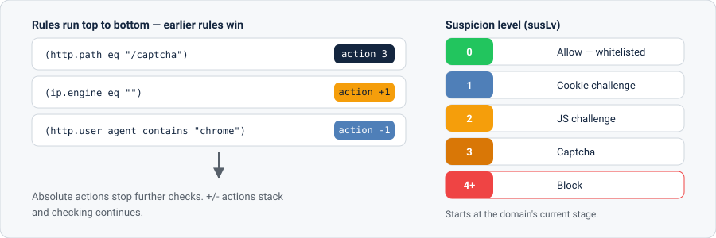

# Custom Firewall Rules

Thanks to [gofilter](https://github.com/kor44/gofilter), SonuShield lets you add your own firewall rules using a rule engine based on [Wireshark display filter expressions](https://www.wireshark.org/docs/wsug_html_chunked/ChWorkBuildDisplayFilterSection.html).



## Fields

These fields can be used in rule expressions. Values reflect the current request and the current rate-limit window.

| Field | Type | Description |
|-------|------|-------------|
| `ip.src` | IP | The client's IP address. |
| `ip.country` | String | The client's ISO country code (e.g. `US`), from the configured GeoIP Country database. `""` when no database is configured or no record exists. In Cloudflare mode, from the `CF-IPCountry` header. |
| `ip.asn` | Int | The client's autonomous system number, from the configured GeoIP ASN database. `0` when no database is configured or no record exists. |
| `ip.engine` | String | The client's browser (`""` if it could not be identified). |
| `ip.bot` | String | The bot's name (`""` if not applicable). |
| `ip.fingerprint` | String | The client's raw TLS fingerprint (`Cloudflare` in Cloudflare mode). |
| `ip.ja4` | String | The client's JA4 fingerprint, computed by SonuShield (`""` in Cloudflare mode). Only comparable with other SonuShield-computed JA4 values. |
| `ip.reputation` | String | `"listed"` if the client IP is on the local blocklist or the fetched reputation feed, `""` otherwise. |
| `ip.http_requests` | Int | The client's forwarded HTTP requests in the current rate-limit window. |
| `ip.challenge_requests` | Int | The client's challenge attempts in the current rate-limit window. |
| `http.host` | String | The hostname of the current domain. |
| `http.version` | String | The HTTP version used by the client (for example `HTTP/1.1` or `HTTP/2`). |
| `http.method` | String | The HTTP method used by the client (all capitals). |
| `http.url` | String | The full request URI. |
| `http.query` | String | The raw query string sent by the client. |
| `http.path` | String | The path requested by the client (for example `/pictures/dogs`). |
| `http.user_agent` | String | The user agent sent by the client. **Important:** always lowercased. |
| `http.cookie` | String | The cookie string sent by the client. |
| `http.fingerprint` | String | The `sh1` HTTP request fingerprint (sorted header names and other request properties). SonuShield's own format, comparable only within SonuShield. |
| `proxy.stage` | Int | The stage the reverse proxy is currently in. |
| `proxy.cloudflare` | Bool | `true` if the proxy is in Cloudflare mode. |
| `proxy.stage_locked` | Bool | `true` if the stage is locked to a specific stage. |
| `proxy.attack` | Bool | `true` if the proxy is under attack. |
| `proxy.bypass_attack` | Bool | `true` if the proxy is being attacked by an attack that bypasses the current security measures. |
| `proxy.rps` | Int | Currently incoming requests per second. |
| `proxy.rps_allowed` | Int | Currently incoming requests per second forwarded to the backend. |

> **Do not use** `ip.requests`, `http.headers`, or `http.body` in rules. These names are registered in the rule engine but are never given values, so rules using them will not behave as expected.

## Comparison Operators

```text
(http.path eq "/")            (http.path == "/")            identical
(http.path ne "/")            (http.path != "/")            not identical
(proxy.rps gt 200)            (proxy.rps > 200)             left greater than right
(proxy.rps lt 10)             (proxy.rps < 10)              left smaller than right
(proxy.rps_allowed ge 50)     (proxy.rps_allowed >= 50)     left greater than or equal
(proxy.rps_allowed le 50)     (proxy.rps_allowed <= 50)     left smaller than or equal
```

## Logical Operators

```text
(http.path eq "/" and http.query eq "")     (http.path eq "/" && http.query eq "")     both must be true
(http.path eq "/" or http.query eq "/x")    (http.path eq "/" || http.query eq "/x")   either must be true
!(http.path eq "/")                         not(http.path eq "/")                      negates the comparison
```

## Search / Match Operators

```text
(http.user_agent contains "chrome")                          field contains value
(http.user_agent matches "(?=.*\d)(?=.*[a-z])(?=.*[A-Z])")   field matches a regex
```

## Structure

Firewall rules live in each domain's `firewallRules` array in `config.json`. Every rule needs an `expression` and an `action`:

```json
"firewallRules": [
  {
    "expression": "(http.path eq \"/captcha\")",
    "action": "3"
  },
  {
    "expression": "(http.path eq \"/curl\" and ip.bot eq \"Curl\")",
    "action": "0"
  }
]
```

## Priority

Rules are evaluated from top to bottom. A rule listed earlier has priority over every rule listed after it. Some actions stop SonuShield from checking further matching rules (see below), so rules with higher action values should usually be listed higher in the array as well.

## Actions

The resulting action is decided by the request's `susLv` (suspicion level), a scale from `0` to `3` and above. It starts at the domain's current stage (normally `1`, higher during attacks) and is adjusted by matching rules.

| susLv | Reaction |
|-------|----------|
| `0` | **Allow.** The request is whitelisted and will not be challenged in any form. |
| `1` | **Cookie challenge.** A simple cookie challenge, passed automatically by most good bots. |
| `2` | **JS challenge.** A JavaScript challenge that stops most bots, including good ones. |
| `3` | **Captcha.** A visual captcha the user must solve. Stops most malicious requests as well as good bots. |
| `4` or higher | **Block.** The request is blocked. |

## Adding Actions

An `action` can set the suspicion level to an exact number. When a rule with an absolute action matches, SonuShield stops checking further rules for that request:

```json
{
  "expression": "(http.host contains \":\")",
  "action": "3"
}
```

This example challenges requests whose host contains a `:` (typical of direct socket connections) with a captcha.

```json
{
  "expression": "(ip.country eq \"XX\" and http.path eq \"/wp-login.php\")",
  "action": "3"
}
```

This example (with a GeoIP Country database configured) challenges login-page requests from one country with a captcha. Replace `"XX"` with a real ISO country code.

```json
{
  "expression": "(ip.reputation eq \"listed\")",
  "action": "+1"
}
```

This example raises the suspicion level by `1` for IPs on the local blocklist or reputation feed — on top of the automatic reputation bump (see [IP Reputation](configuration.md#ip-reputation)).

Prefixing the action with `+` or `-` instead adjusts the *current* suspicion level by that amount, and SonuShield keeps checking further rules. This lets you stack multiple checks and react less aggressively when not under attack:

```json
{
  "expression": "(ip.engine eq \"\")",
  "action": "+1"
}
```

This example raises the suspicion level by `1` for requests from an unknown browser engine. A `-1` action would lower it by `1`.

## Next Steps

- [Configuration](configuration.md) — the `firewallRules` array lives per domain.
- [How It Works](how-it-works.md) — how suspicion levels and stages interact.
