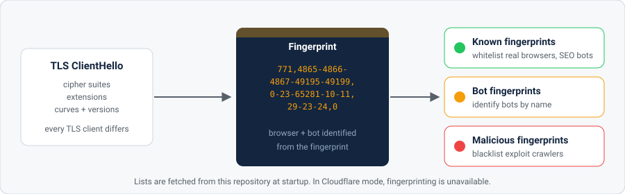
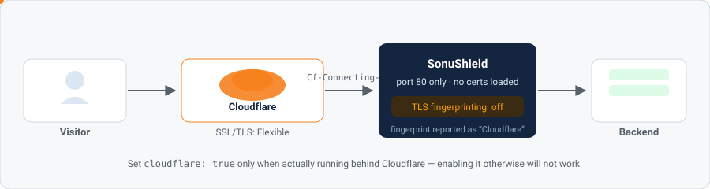
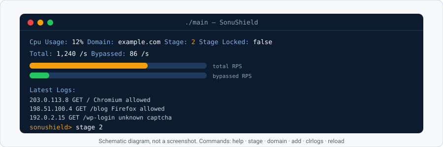

# How It Works

What SonuShield does to every request, how the staged challenges escalate, and how Cloudflare mode changes the picture.

## Request Flow

SonuShield sits in front of your web server as a reverse proxy. For each request:

1. The TLS connection is fingerprinted (outside Cloudflare mode) and the browser/bot is identified. A JA4 fingerprint is computed alongside the legacy fingerprint, and an HTTP/2 fingerprint from the signals Go's stack exposes.
2. Rate limits are checked, then WAF-lite inspection runs (log-only by default), followed by the honeypot check and fake search-bot verification when configured.
3. Your per-domain [firewall rules](firewall-rules.md) run — edge rules first, then general rules — adjusting the request's suspicion level; listed IPs then receive the reputation bump. In dry-run mode, rule matches are only logged.
4. Depending on the suspicion level and the domain's current stage, the request is allowed, challenged, or blocked. Confirmed-bad requests may be tarpitted when configured.
5. Passed requests check the edge cache (when enabled) and the waiting room (when enabled and loaded), then the API-protection gate (JWT, API keys, GraphQL limits when configured), and are forwarded to your backend — distributed across backends when several are configured — with extra headers (see below). When every backend is down, a stale cached copy is served, clearly marked, when one exists.

Requests to the API, dashboard, metrics, and public API paths that carry a valid secret bypass the challenge flow entirely (step 4 never applies to them) and are answered before counting; requests with a missing or wrong secret fall through to the normal flow above, exactly like visitor traffic.

Requests forwarded to your backend carry extra headers your backend can read: `x-real-ip`, `proxy-real-ip` (both the client IP), and `proxy-tls-fp` (the client's TLS fingerprint, or `Cloudflare` in Cloudflare mode).

Outside Cloudflare mode, plain HTTP requests on port 80 are redirected to HTTPS (301), except for unknown hosts, which receive an error message (generic when `quietMode` is on), and Let's Encrypt HTTP-01 challenge requests, which are answered on port 80 when `autoSSL` is enabled. In Cloudflare mode the proxy serves plain HTTP on port 80 only.

## TLS Fingerprinting

TLS fingerprinting opens up a whole new range of ways to defend against malicious attacks. You can use it to whitelist specific fingerprints (for example, SEO bots), blacklist unwanted fingerprints (for example, WordPress exploit crawlers), rate-limit attackers that change IPs through proxies, or simply learn more about a visitor.

At startup, SonuShield fetches three legacy fingerprint lists from this repository: known fingerprints, bot fingerprints, and malicious fingerprints. It also fetches three JA4 lists (known, bot, malicious), which start empty, and merges an optional local `ja4_fingerprints.json` file over them (see [Configuration](configuration.md#ja4-local-overrides)). JA4 values are computed from the TLS fields Go's standard library exposes, which does not include the raw extension list — so SonuShield JA4 values are only comparable with other SonuShield-computed values, never with external JA4 databases. When the legacy fingerprint is unknown, the JA4 lists are consulted to fill in the browser/bot identification, and JA4 values in the malicious list block the request just like legacy forbidden fingerprints. In Cloudflare mode, TLS fingerprinting is not available: the fingerprint and browser are reported as `Cloudflare` instead.

## Staged DDoS Mitigation

SonuShield comes with 3 distinct challenges. It starts with the weakest, least noticeable challenge and automatically switches to stronger ones when it detects the current one is being bypassed.

| Stage | Challenge | Effect |
|-------|-----------|--------|
| 1 | Cookie challenge | Invisible; stops simple attacks |
| 2 | Proof-of-work JS challenge | Stops more advanced bots |
| 3 | Custom captcha | Last resort; stops most malicious requests and good bots too |

Stage switching is automatic and driven by the per-domain thresholds in your configuration (see [Stage Thresholds](configuration.md#stage-thresholds)). You can also lock a stage manually with the [`stage`](#commands) terminal command. Firewall rules can raise a request's suspicion level above the current stage; a level of 4 or higher blocks the request outright (see [Custom Firewall Rules](firewall-rules.md)).

### Cookie Challenge

The cookie challenge is completely invisible and supported by every web browser as well as most HTTP libraries. It is an effective method to defend against simple DDoS attacks.

### PoW JS Challenge

The proof-of-work JavaScript challenge reliably blocks slightly more advanced bots while impacting the user experience as little as possible. The visitor sees a loading animation with the text "Completing challenge ..." while their browser solves a small proof-of-work puzzle automatically; the page then reloads into the protected site. The challenge page also displays the `publicSalt` and `challenge` values used for that attempt.

Solve times measured by the original project:

| Difficulty | Approx. solve time |
|------------|--------------------|
| 5 | ~3.100 seconds |
| 4 | ~0.247 seconds |
| 3 | ~0.244 seconds |
| 2 | ~0.215 seconds |
| 1 | ~0.212 seconds |

The difficulty is set per domain with `stage2Difficulty` (default `5` when unset). With `adaptivePow` enabled, the difficulty instead scales with the domain's bypassed requests per second between `bypassStage1` and `bypassStage2`, within the `powDifficultyMin`/`powDifficultyMax` bounds (see [Configuration](configuration.md#adaptive-proof-of-work)). Note: the challenge page loads the `balooPow` proof-of-work script from a public CDN (the `41Baloo/balooPow` repository). Your visitors' browsers must be able to reach that CDN for Stage 2 challenges to complete.

A domain can alternatively serve a Cloudflare Turnstile or hCaptcha challenge at Stage 2 instead of the proof-of-work page, using the operator's own provider keys (`challengeProvider`, `challengeSiteKey`, `challengeSecretKey`). The provider page uses an invisible-mode widget with automatic execution and verifies the token server-side; on success the visitor receives the same clearance cookie as the proof-of-work flow. Without valid keys the domain falls back to proof-of-work (see [Configuration](configuration.md#challenge-providers)).

### Custom Captcha

The custom captcha should be your last resort, or be used to protect especially weak pages. The visitor drags a slider to reveal green text hidden in a picture, then types the text (up to 6 characters) into the form. This stops most malicious requests as well as good bots.

## Cloudflare Mode

Not everyone can afford expensive servers and a global CDN. SonuShield can run behind Cloudflare: set `cloudflare` to `true` in your configuration. In this mode the proxy listens on port 80 only, reads the client IP from the `Cf-Connecting-Ip` header, does not load TLS certificates, and TLS fingerprinting is unavailable. Your Cloudflare SSL/TLS encryption mode must be set to `Flexible` for this to work. Enabling Cloudflare mode without actually using Cloudflare will not work.

## Startup Checks

At startup, SonuShield fetches the TLS fingerprint lists (three legacy lists plus three JA4 lists) and the version information from this repository over HTTPS (`raw.githubusercontent.com`). The version check compares the published stable version against the built-in version (`1.5`); if a newer stable version exists, the proxy prints an update notice and waits 10 seconds before starting. If the version check itself fails (for example, with no outbound network access), startup stops. Fingerprint-list fetch failures do not stop startup, but leave the corresponding lists empty.

## Terminal

While SonuShield runs, the terminal shows a live HUD for the watched domain and accepts commands typed at the prompt.

### Main HUD

| Field | Description |
|-------|-------------|
| Cpu Usage | Current CPU usage of the server, in percent. |
| Domain | The domain currently being watched. |
| Stage | The stage the watched domain is currently in. |
| Stage Locked | `true` if the stage was manually set and locked with the `stage` command. |
| Total | Incoming requests per second across all requests. |
| Bypassed | Requests per second that passed the proxy and were forwarded to the backend. |
| Latest Logs | Information about the most recent requests. The number of lines shown follows the terminal height. |

### Commands

| Command | Description |
|---------|-------------|
| `help` | Shows a summary of all available commands. Type anything or press Enter to exit the help view. |
| `stage [number]` | Sets the watched domain's stage to the given number and locks it there, no matter what — even during an ongoing attack that bypasses that stage. `stage 0` unlocks the stage, resets it to 1, and re-enables automatic stage switching. A stage higher than 3 blocks all requests. |
| `domain [name]` | Switches the watched domain. With no name, lists all available domains. |
| `add` | Starts an interactive dialogue to add another domain to the proxy, then reloads the configuration. You can also edit `config.json` directly, but that requires a `reload` (or restart) to apply. |
| `clrlogs` | Clears the logs for the watched domain, or for all domains when no domain is being watched. |
| `reload` | Re-reads `config.json` and applies changes, resetting some general settings. Run this after editing the configuration by hand. |

## Next Steps

- [Features](features.md) — everything SonuShield can do, with visuals.
- [Configuration](configuration.md) — thresholds, rate limits, webhooks.
- [Dashboard](dashboard.md) — monitor it all from the browser.
